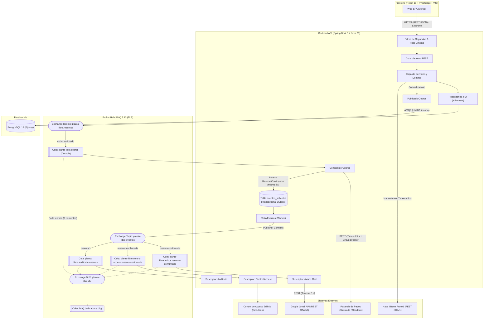

# Planta Libre — Documento de Entrega: 3.er Checkpoint

**Universidad Argentina de la Empresa (UADE)**  
**Facultad de Ingeniería y Ciencias Exactas**  
**Carrera:** Licenciatura en Sistemas  
**Materia:** Desarrollo de Aplicaciones II (DAII)  
**Grupo 7:** Berrotarán, Pedro · Checa Orihuela, Keila Nicole · Lussoro, Nicolás  
**Fecha de entrega:** 20 de noviembre de 2026  
**Hito:** 3.er Checkpoint — Integración Completa y Resiliencia  
**Repositorios:** [Backend (Spring Boot 3)](https://github.com/pedroberro/Back-Desarrollo-de-Aplicaciones-II) · [Frontend (React 19)](https://github.com/pedroberro/Front-Desarrollo-de-Aplicaciones-II)  
**Despliegue activo:** [Web (Vercel)](https://planta-libre-ashen.vercel.app) · [API REST (Render)](https://planta-libre-api.onrender.com)

---

## 1. Integraciones del Sistema

El sistema **Planta Libre** articula una arquitectura monolítica modular en capas en el backend y una SPA reactiva en el frontend, integrada con servicios externos y un broker de mensajería distribuido bajo protocolos seguros.



### 1.1 Integraciones REST (Síncronas)

1. **Frontend ↔ Backend (`/api/*`):**  
   Comunicación sobre HTTPS con payloads JSON. Toda la navegación, renderizado del plano en grilla y validación de franjas horarias se resuelve mediante invocaciones REST síncronas tipadas, respetando el contrato OpenAPI 3.1 publicado en `/v3/api-docs`.
2. **Backend → Pasarela de Pagos (`PasarelaPagos`):**  
   Invocación síncrona ejecutada dentro del worker asincrónico de cobro. Comunica con el simulador de pasarela mediante peticiones HTTP estructuradas. Emula cargos aprobados, rechazos por fondos insuficientes y escenarios de latencia/falla de red mediante números de tarjeta de prueba predefinidos.
3. **Backend → Google Gmail API (`GmailApiEmailService`):**  
   Envío de correos transaccionales (confirmación de cuenta, blanqueo de clave, comprobante de reserva y avisos de cancelación) mediante HTTPS sobre la API REST de Google Workspace con tokens OAuth 2. Esta arquitectura sustituye al protocolo SMTP tradicional, el cual es sistemáticamente bloqueado en los puertos salientes 25/465/587 por proveedores de hosting PaaS como Render.
4. **Backend → Pwned Passwords (`PwnedPasswordsCliente`):**  
   Verificación de seguridad en tiempo real durante el registro y cambio de contraseña. Consume la API REST de *Have I Been Pwned* aplicando el modelo de **k-anonimato**: el cliente calcula el hash SHA-1 de la clave candidata, envía únicamente los primeros 5 caracteres hexadecimales y el backend busca localmente si el sufijo restante figura entre los hashes comprometidos, sin exponer la contraseña del usuario.

### 1.2 Integración por Mensajería (AMQP / RabbitMQ sobre TLS)

El sistema opera con dos topologías de mensajería desacopladas en RabbitMQ 3.13 con cifrado TLS:

1. **Cola Punto a Punto (`planta-libre.cobros`):**
   * **Patrón:** *Competing Consumers* sobre un Direct Exchange (`planta-libre.reservas`).
   * **Propósito:** Procesamiento asincrónico de cobros. Cuando el cliente confirma una reserva en el endpoint `POST /api/reservas`, la reserva se persiste en estado `PENDIENTE` en milisegundos y se emite un mensaje `CobroSolicitado`.
   * **Garantía:** El modelo de cola punto a punto garantiza que cada solicitud de cobro sea procesada **por una única instancia consumidora**, habilitando el escalado horizontal del backend sin riesgo de duplicación de transacciones financieras.
2. **Tópico de Eventos Pub/Sub (`planta-libre.eventos`):**
   * **Patrón:** *Publish/Subscribe* sobre un Topic Exchange con enrutamiento por comodines (`reserva.*`).
   * **Propósito:** Distribución del evento `reserva.confirmada`. Desacopla la lógica de negocio de los múltiples sistemas interesados:
     * `planta-libre.avisos.reserva-confirmada`: Cola del suscriptor de notificaciones por mail.
     * `planta-libre.control-acceso.reserva-confirmada`: Cola del suscriptor que interactúa con el sistema de control de accesos físico del edificio.
     * `planta-libre.auditoria.reservas`: Cola del suscriptor de auditoría que suscribe al patrón amplio `reserva.*`: hoy recibe `reserva.confirmada` y recibirá cualquier otro evento de reservas que se publique, sin cambios.

### 1.3 Justificación sobre Integración SOAP (Si Aplica)

* **Determinación:** **No aplica.**
* **Justificación técnica formal:** En las etapas preliminares del diseño arquitectónico se analizó la posibilidad de integrar el webservice SOAP `WSFEv1` de ARCA/AFIP para la facturación electrónica de las reservas. No obstante, dicho requerimiento fue clasificado formalmente como **fuera de alcance (*Out-of-Scope*)**, tal como está asentado en la sección 2 del documento de arquitectura [Integracion.md](Integracion.md) y en la sección 1 del [PlanDePruebas.md](PlanDePruebas.md). Todos los actores externos vigentes (pasarela de cobros, proveedor de correos Google y servicio de ciberseguridad HIBP) ofrecen interfaces nativas REST bajo estándares web modernos. Forzar una integración SOAP artificial sobre servicios que nativamente operan en REST hubiera violado el principio de diseño *KISS* (Keep It Simple, Stupid) e introducido dependencias de transformación XML/WSDL injustificadas.

---

## 2. Arquitectura de Resiliencia y Tolerancia a Fallos

La resiliencia en Planta Libre garantiza el aislamiento de fallas (*fault isolation*) ante indisponibilidad de proveedores externos o intermediarios de red.

### 2.1 Timeout de 5 Segundos con Fallback

Se implementó el patrón **Decorator** sobre los adaptadores de salida:
* **Pasarela de Pagos (`PasarelaPagosResiliente`):** Envuelve el puerto `PasarelaPagos` con un límite estricto de **5.000 ms** respaldado por un *Circuit Breaker*.
  * *En el proceso de cobro:* Si la pasarela no responde dentro de los 5 s, la transacción se interrumpe, se incrementa el contador de fallas del circuito y el mensaje se deriva a reintento con backoff exponencial.
  * *En la cancelación de reserva:* Si la pasarela demora más de 5 s en devolver el dinero, la transacción efectúa un rollback atómico: la reserva permanece en estado `CONFIRMADA` (no se cancela sin devolver los fondos) y la API responde HTTP `503 Service Unavailable` con la cabecera `Retry-After: 30`.
* **Pwned Passwords (`PwnedPasswordsCliente`):** Límite de 5 s. Si la API de HIBP está caída o degrada su latencia, se activa el *fallback determinista*: se valida la clave contra el archivo local compilado de contraseñas vulnerables y se registra una advertencia en el log sin bloquear el registro del usuario.
* **Gmail API (`GmailApiEmailService`):** Límite de 5 s ejecutado en un hilo desacoplado (`@Async`). Si Google no responde, el fallo se captura y se asienta en el log sin degradar la respuesta HTTP hacia el cliente.

### 2.2 Consumidores Idempotentes y Dead Letter Queue (DLQ)

La idempotencia en el consumo asincrónico se asegura en tres niveles:
1. **Firma digital del mensaje:** Cada mensaje contiene un identificador único `mensajeId` (UUID) y va firmado con HMAC-SHA256 sobre el identificador y el cuerpo.
2. **Deduplicación persistida:** La tabla `mensajes_procesados` (clave primaria `mensaje_id`; en el tópico, `suscriptor:id`) registra el procesamiento en la misma transacción de base de datos. Si un mensaje repetido ingresa al consumidor por retransmisión de red, la inserción atómica (`ON CONFLICT DO NOTHING`) detecta el duplicado y el consumidor lo descarta en forma inocua (*no-op*).
3. **Restricción a nivel entidad:** La tabla `cobros` contiene una restricción de unicidad `UNIQUE (reserva_id)`, imposibilitando físicamente que una reserva posea dos cobros registrados.
* **Gestión de fallos transitorios y DLQ:** Errores recuperables disponen de 3 reintentos con intervalo exponencial. Superado el umbral, el broker enruta el mensaje mediante `planta-libre.dlx` a la cola `planta-libre.cobros.dlq`. Cada cola de suscriptor del tópico (`avisos`, `control-acceso`, `auditoria`) cuenta con su propia DLQ independiente.

### 2.3 Garantía ante Caída del Broker (Sin Pérdida de Mensajes)

Si el servicio RabbitMQ se interrumpe por caída de nodo o falla de red:
* **Flujo de Cobros:** La necesidad de cobro se registra dentro de la transacción SQL que inserta la reserva (`reservas.cobro_solicitado_el`). El componente `BarridoCobros` ejecuta una tarea periódica cada 60 segundos que detecta reservas pendientes que no hayan recibido respuesta de cobro y las reinyecta en la cola AMQP en cuanto el broker vuelve a operar.
* **Flujo de Tópicos (Transactional Outbox):** Al confirmarse una reserva (por cobro exitoso o por acción del administrador), el evento `ReservaConfirmada` se inserta en la tabla `eventos_salientes` dentro del mismo `COMMIT` de base de datos. El servicio `RelayEventos` recupera los registros pendientes y los publica al exchange empleando *Publisher Confirms*. Si RabbitMQ está fuera de línea, los eventos quedan encolados en disco en PostgreSQL y son emitidos en estricto orden cronológico una vez restablecido el enlace.

### 2.4 Control de Concurrencia en la API REST: Idempotency-Key y ETag

* **Idempotencia en peticiones mutables (`Idempotency-Key`):**
  * Soportada en `POST /api/reservas`, `POST /api/admin/reservas` y `POST /api/usuarios/me/medios-pago` conforme al draft IETF.
  * El filtro `@Idempotente` intercepta la clave provista en el header y valida contra la tabla `claves_idempotencia`.
  * Si la solicitud se repite con el mismo payload, se recupera el código HTTP y el body de la base, retornando el resultado original con la cabecera `Idempotent-Replayed: true`.
  * Si se detecta la misma clave con un cuerpo alterado, la API responde HTTP `422 Unprocessable Entity`.
* **Control optimista de concurrencia (`ETag` e `If-Match`):**
  * Basado en la especificación RFC 9110.
  * Endpoints de lectura (`GET /api/reservas/{id}`, `GET /api/usuarios/me`, `GET /api/usuarios/me/medios-pago/{id}`) exponen el header `ETag` derivado de la columna `version` de las tablas correspondientes (incrementada automáticamente por triggers de PostgreSQL).
  * Endpoints de actualización (`PUT /api/admin/reservas/{id}`, `PUT /api/usuarios/me/medios-pago/{id}`, `PATCH /api/usuarios/me`) aceptan el encabezado `If-Match`. El backend bloquea temporalmente la fila (`SELECT ... FOR UPDATE`), verifica si la versión del `If-Match` coincide con la versión en disco y, de no coincidir (edición concurrente por parte de otro operador), interrumpe el procesamiento respondiendo HTTP `412 Precondition Failed`. El encabezado es opcional: sin `If-Match`, el cambio se aplica igual.

### 2.5 Respuestas de Error Estandarizadas con Problem Details (RFC 9457)

Todos los errores emitidos por la API adoptan el tipo de contenido estándar `application/problem+json` a través de `@RestControllerAdvice` (`GlobalExceptionHandler`). Los filtros de seguridad, el límite de tasa y la Idempotency-Key responden en el mismo formato: todos los errores se arman con un único constructor (`Problemas.de`). Ejemplo real de una franja tomada:

```json
{
  "type": "urn:planta-libre:problema:FRANJA_OCUPADA",
  "title": "Conflicto con el estado actual",
  "status": 409,
  "detail": "P3-12 ya está reservado entre las 10:00 y las 12:00, que se superpone con el horario elegido.",
  "instance": "/api/reservas",
  "message": "P3-12 ya está reservado entre las 10:00 y las 12:00, que se superpone con el horario elegido.",
  "code": "FRANJA_OCUPADA",
  "alternativas": [
    { "inicio": "2026-12-01T12:00:00", "fin": "2026-12-01T14:00:00" }
  ]
}
```

* **Extensiones de dominio:** Errores por colisión de horario incluyen `alternativas` calculadas en vivo por el motor de disponibilidad; transiciones inválidas de la máquina de estados devuelven `TRANSICION_INVALIDA`.
* **Protección contra fuga de información:** Fallos no controlados del servidor retornan HTTP `500 Internal Server Error` neutro y sin stack traces, aislando nombres de tablas, clases Java o esquemas de base de datos del cliente.

---

## 3. Estado de la Funcionalidad de IA

### 3.1 Estado actual: asistente de navegación en desarrollo

El asistente recibe consultas en lenguaje natural y sugiere a qué pantalla ir. Está en desarrollo; hoy existen el contrato y el catálogo de acciones, en los dos repositorios:
* **`AsistenteDtos`:** contrato HTTP. La consulta lleva un `message` de hasta 1000 caracteres; la respuesta trae `message`, `action` y `buttonLabel`.
* **Catálogo cerrado de acciones** (`acciones.ts` y enum `Accion`): `GO_TO_RESERVATIONS`, `GO_TO_MY_RESERVATIONS` y `GO_TO_AVAILABILITY`. El asistente devuelve un identificador, nunca una URL: un valor desconocido no navega y la autorización de cada pantalla sigue a cargo de las rutas protegidas.
* **Pendiente:** todavía no están implementados el endpoint del asistente ni la conexión con un proveedor de modelo.

### 3.2 Análisis de Viabilidad y Decisión de Alcance

En el marco del estudio documentado en [PropuestasIA.md](PropuestasIA.md), el equipo evaluó tres casos de uso:
1. *Búsqueda de espacios por lenguaje natural:* Conversión de texto libre a parámetros de búsqueda.
2. *Reubicación automática ante bloqueos:* Asignación de espacios equivalentes al suspenderse un piso.
3. *Pronóstico de demanda y detección de no-shows:* Modelado predictivo de ocupación.

**Conclusión y justificación técnica:**
* El catálogo del sistema cuenta con un dominio acotado de 522 espacios estructurados en 4 tipos cerrados, niveles de ruido fijos y equipamiento tipificado.
* Todo requerimiento funcional se resuelve con mayor eficiencia computacional, cero costo operativo y **100 % de determinismo mediante lógica algorítmica convencional** (`MotorDisponibilidad` en memoria, cálculo de intersección de conjuntos y asignación greedy), ahorrando entre un 35 % y un 85 % de horas de desarrollo.
* Someter el runtime transaccional a APIs externas de LLMs introducía variabilidad estocástica no asegurable por pruebas unitarias, latencia imprevisible y riesgos de corte de servicio por límites de cuota en entornos demo.
* Por consiguiente, **la IA no participa de las reglas de negocio** (disponibilidad, reservas y cobros): se limita al asistente de navegación de la sección 3.1, que no modifica datos. Ver [PropuestasIA.md](PropuestasIA.md).

### 3.3 Uso de IA en el Proceso de Ingeniería

La inteligencia artificial se incorporó formalmente como acelerador del **proceso de calidad y testing (Eje E)**:
* Asistencia en el diseño de mutantes para PITest.
* Parametrización exhaustiva de escenarios de borde en JUnit 5.
* Formulación de criterios de seguridad en sintaxis BDD / Gherkin para la suite Newman.

---

## 4. Pipeline de CI/CD y Reporte de Cobertura Parcial

El aseguramiento de calidad se ejecuta en cada push y pull request en GitHub Actions mediante el workflow [.github/workflows/ci.yml](../.github/workflows/ci.yml).

### 4.1 Fases del Pipeline

1. **Job `build` (Compilación, Pruebas y Análisis Estático):**
   * Runner: `ubuntu-latest` con JDK 21 Temurin y caché Maven.
   * Ejecuta: `mvn -B -ntp verify`.
   * Herramientas activas:
     * **JaCoCo:** Instrumentación de bytecode para cálculo de cobertura de código.
     * **PITest:** Análisis de mutación sobre clases de negocio.
     * **SpotBugs + FindSecBugs:** Detección de vulnerabilidades de seguridad estática (OWASP Top 10).
2. **Job `api` (Pruebas de Integración de API y Contrato):**
   * Inicializa un servicio de base de datos **PostgreSQL 16** efímero en contenedor Docker.
   * Genera secretos criptográficos aleatorios de 256 bits por corrida.
   * Levanta el JAR compilado de la aplicación en segundo plano.
   * **Newman:** Ejecuta la colección Postman de 99 peticiones validando endpoints y códigos de error.
   * **Schemathesis:** Fuzzing y validación de contrato contra `/v3/api-docs`.
3. **Job `dependencias` (Escaneo de dependencias):**
   * OSV-Scanner revisa las dependencias Maven, directas y transitivas, contra la base OSV y publica el resultado en el resumen de la corrida, sin cortar el build. Dependabot abre cada semana los PR de actualización de Maven, GitHub Actions e imágenes Docker.
   * En el repositorio del frontend, el CI corre oxlint, OSV-Scanner sobre `package-lock.json` (corta el build si encuentra vulnerabilidades), las pruebas de UI con Vitest, el type check, el build de producción y la imagen Docker.

### 4.2 Reporte de Métricas de Cobertura (Corrida del 19/11/2026)

```
========================================================================================
REPORTE DE CALIDAD Y COBERTURA DE CÓDIGO (JACOCO / PITEST / SPOTBUGS)
========================================================================================
MÉTRICA AUDITADA                                     VALOR MEDIDO    UMBRAL      ESTADO
========================================================================================
Pruebas Unitarias e Integración (JUnit 5)            255 ejecutadas  100 %       APROBADO
Pruebas Exitosas / Fallos                              255 / 0         0 fallas  APROBADO
Cobertura de Líneas en Capa Negocio (domain/service) 94,6 %          >= 80,0 %   APROBADO
Cobertura de Ramas en Capa Negocio (domain/service)  78,9 %          >= 70,0 %   APROBADO
Mutation Score de Dominio (PIT Mutation Testing)     74,0 % (115/155)>= 60,0 %   APROBADO
Vulnerabilidades SpotBugs / FindSecBugs (Alta)       0 hallazgos     0           APROBADO
Colección Automatizada Newman (Postman)               99 pasados      100 %       APROBADO
Validación de Esquema OpenAPI (Schemathesis)         0 anomalías     100 %       APROBADO
Pruebas de UI del frontend (Vitest)                  9 pasadas       100 %       APROBADO
========================================================================================
```

---

## 5. Primera Versión del Plan de Pruebas

El plan de pruebas formal está estructurado bajo la norma **ISO/IEC/IEEE 29119-3** ([docs/PlanDePruebas.md](PlanDePruebas.md)).

### 5.1 Alcance del Testing

* **Dentro del alcance:** Endpoints REST de la API, persistencia en PostgreSQL con migraciones Flyway, mensajería asincrónica en RabbitMQ con TLS, adaptadores simulados (pasarela de pagos, Gmail API, HIBP, control de accesos), flujos de usuario cliente y administrador en React 19.
* **Fuera del alcance:** Interfaz SOAP (inexistente en el ecosistema), IA en las reglas de negocio y pasarela de cobros real en producción.

### 5.2 Niveles de Prueba y Herramientas

| Nivel de Prueba | Herramientas Utilizadas | Ámbito de Ejecución | Cobertura / Objetivo |
|---|---|---|---|
| **Unitario** | JUnit 5, AssertJ, Mockito | Paquetes `domain`, `service`, `security`, `controller` | Máquina de estados, reglas de negocio, motor de disponibilidad, cálculo de tarifas. |
| **Integración** | Spring Boot Test, Testcontainers (PostgreSQL 16 y RabbitMQ 3.13 reales) | Paquete `integracion` | Persistencia real, bloqueos de concurrencia, reintentos AMQP, ETag, Idempotency-Key. |
| **Mutación** | PITest | Maven target `pit-reports` | Eficacia de la suite de pruebas unitarias sobre el modelo de dominio. |
| **API** | Postman, Newman | `api-tests/PlantaLibre.postman_collection.json` | 99 casos verificando respuestas exitosas y errores controlados (400, 401, 403, 404, 405, 409, 412, 422). |
| **Contrato** | Schemathesis | Job `api` de CI | Conformidad estricta contra la especificación OpenAPI 3.1 sin errores 5xx. |
| **UI (frontend)** | Vitest, Testing Library (jsdom) | `src/**/*.test.tsx` del frontend | Flujo de reserva: confirmar con la tarjeta elegida, franja tomada con alternativas, choque con otra reserva propia y falta de tarjetas. |
| **Análisis Estático** | SpotBugs, FindSecBugs | `mvn verify` | Prevención de vulnerabilidades de seguridad estática e inyecciones. |
| **Dependencias** | OSV-Scanner, Dependabot | CI de back y front | Vulnerabilidades conocidas en las dependencias. El front corta el build; el back reporta en el resumen. |

### 5.3 Matriz de Gestión de Riesgos Críticos (R1 a R13)

| # | Riesgo | P | I | P×I | Estrategia de Mitigación en Arquitectura | Verificación Automatizada |
|---|---|:---:|:---:|:---:|---|---|
| **R1** | Doble reserva sobre la misma franja (Race condition) | 3 | 3 | **9** | Bloqueo pesimista `SELECT FOR UPDATE` en `TomaDeFranja` + restricción `EXCLUDE USING gist` en PostgreSQL. | `ReservasClienteIntegracionTest`, `ReservaRepositoryIntegracionTest` |
| **R2** | Cobro duplicado por doble clic o retransmisión | 2 | 3 | **6** | Consumidor idempotente (`mensajes_procesados`, `UNIQUE cobros.reserva_id`) + `Idempotency-Key`. | `CobroServiceImplTest`, `MensajeriaIntegracionTest`, `IdempotenciaIntegracionTest` |
| **R3** | Pasarela de pagos no responde y agota hilos | 2 | 3 | **6** | Timeout estricto de 5 s, Circuit Breaker (`PasarelaPagosResiliente`), reintentos con backoff y DLQ. | `PasarelaPagosResilienteTest`, `PasarelaLentaIntegracionTest`, `BarridoCobrosTest` |
| **R4** | Pérdida de mensajes ante caída del broker AMQP | 2 | 3 | **6** | Cobro: asentado en BD y recuperado por `BarridoCobros`. Tópico: Transactional Outbox y `RelayEventos`. | `BarridoCobrosTest`, `MensajeriaIntegracionTest` |
| **R5** | Acceso o modificación de datos ajenos (BOLA/IDOR) | 2 | 3 | **6** | Identidad extraída exclusivamente del token JWT en sesión. Recursos ajenos responden 404. | `ReservasClienteIntegracionTest.laReservaDeOtroClienteNoSeVe`, `MediosPagoIntegracionTest` |
| **R6** | Cliente accede a rutas administrativas (BFLA) | 2 | 3 | **6** | Autorización declarativa `@PreAuthorize` por permisos finos. Sin permiso responde 403. | `AdminReservasIntegracionTest.unClienteNoEntraAlPanelDelAdmin`, `AutenticacionIntegracionTest.unClienteNoVeElListadoDeUsuariosNiLaAuditoria` |
| **R7** | Transición de estado inválida de una reserva | 2 | 2 | **4** | Patrón State en `EstadoReserva`. Transiciones ilegales responden HTTP 409 `TRANSICION_INVALIDA`. | `EstadoReservaTest` (40 casos), `TransicionesReservaIntegracionTest` |
| **R8** | Dos administradores modifican la misma reserva a la vez | 2 | 2 | **4** | Control optimista con `ETag` e `If-Match`. El segundo operador recibe HTTP 412. | `EtagIntegracionTest.dosAdministradoresEditandoLaMismaReservaElSegundoRecibe412` |
| **R9** | Fuerza bruta sobre autenticación o endpoints públicos | 2 | 2 | **4** | Rate Limiting persistido en base de datos (`limites_intentos`). Responde HTTP 429 con `Retry-After`. | `LimitadorDeIntentosTest`, `LimiteTasaIntegracionTest` |
| **R10** | Discrepancia con el contrato de API publicado | 2 | 2 | **4** | Validación continua en pipeline mediante Schemathesis contra `/v3/api-docs`. | `ContratoApiIntegracionTest`, Schemathesis en CI |
| **R11** | Reintegro erróneo al cancelar una reserva | 1 | 3 | **3** | Cálculo estricto en `PoliticaCancelacion` (100%, 50%, 0%) y rollback transaccional ante fallos. | `PoliticaCancelacionTest`, `CancelacionesTest` |
| **R12** | Indisponibilidad de Gmail API o HIBP bloquea el sistema | 1 | 2 | **2** | Timeout de 5 s, ejecución en hilo secundario y fallback a lista local. | `GmailApiEmailServiceTest`, `AuthServiceImpl` |
| **R13** | Confirmación duplicada o emitida sin commit | 1 | 2 | **2** | Outbox persistido en la misma transacción del cambio; deduplicación por suscriptor. | `MensajeriaIntegracionTest.elEventoSoloQuedaEnElOutboxSiLaTransaccionConfirma` |

### 5.4 Inventario de Pruebas Automatizadas (255 Tests JUnit 5)

| Clase de Prueba | Nivel | Cantidad | Foco de Validación |
|---|:---:|:---:|---|
| `domain.enums.EstadoReservaTest` | Unitario | 40 | Transiciones válidas e inválidas de la máquina de estados. |
| `domain.disponibilidad.MotorDisponibilidadTest` | Unitario | 11 | Algoritmo puro de detección de huecos, franjas y contigüidad. |
| `domain.disponibilidad.ReglasReservaTest` | Unitario | 8 | Reglas de uso (30 min - 8 h, días hábiles, anticipación). |
| `domain.cobro.PoliticaCancelacionTest` | Unitario | 5 | Porcentajes de reintegro según ventana horaria. |
| `domain.cobro.TarifarioTest` | Unitario | 3 | Prorrateo de tarifas por tipo de espacio. |
| `service.impl.CobroServiceImplTest` | Unitario | 9 | Orquestación de cobros, idempotencia y estados resultantes. |
| `service.impl.CancelacionesTest` | Unitario | 6 | Cancelaciones de reservas y coordinación de reintegros. |
| `service.impl.PasarelaPagosResilienteTest` | Unitario | 6 | Comportamiento ante timeouts de 5 s y circuit breaker. |
| `service.impl.PasarelaPagosSimuladaTest` | Unitario | 5 | Respuestas sandbox según tarjeta provista. |
| `service.impl.BarridoCobrosTest` | Unitario | 4 | Detección y reintento de cobros demorados. |
| `service.impl.GmailApiEmailServiceTest` | Unitario | 2 | Timeout y manejo de errores del servicio de correo. |
| `service.impl.ControlAccesoSimuladoTest` | Unitario | 2 | Habilitación de accesos físicos ante eventos. |
| `service.PrecondicionTest` | Unitario | 3 | Validaciones de precondiciones en capa de servicio. |
| `controller.EtagsTest` | Unitario | 12 | Generación y parseo de encabezados ETag / If-Match. |
| `security.SeguridadTest` | Unitario | 9 | Reglas de autorización por rol, permisos y cabeceras CSP. |
| `security.LimitadorDeIntentosTest` | Unitario | 6 | Lógica de contadores de rate limiting y bloqueos. |
| `security.SesionesTest` | Unitario | 3 | Ciclo de vida y rotación de refresh tokens. |
| `mensajeria.MonitorDlqTest` | Unitario | 4 | Alerta única en auditoría y por mail ante mensajes nuevos en una DLQ. |
| `integracion.TransicionesReservaIntegracionTest` | Integración | 15 | Respuestas HTTP 409 ante transiciones ilegales en base real. |
| `integracion.AdminReservasIntegracionTest` | Integración | 14 | Operaciones CRUD administrativas, motivos y bitácora. |
| `integracion.CatalogoIntegracionTest` | Integración | 11 | Consulta de plano, filtros y jerarquía sobre catálogo real. |
| `integracion.ContratoApiIntegracionTest` | Integración | 10 | Cumplimiento del contrato OpenAPI 3.1. |
| `integracion.ReservasClienteIntegracionTest` | Integración | 9 | Alta de reservas, concurrencia de franjas y vista cliente. |
| `integracion.AutenticacionIntegracionTest` | Integración | 10 | Registro, confirmación, login, 2FA, sesión, vencimiento del link de recuperación y bitácora sin datos sensibles. |
| `integracion.BloqueosIntegracionTest` | Integración | 7 | Bloqueos de espacios y cancelación en cascada con reintegro. |
| `integracion.MediosPagoIntegracionTest` | Integración | 6 | Alta de tarjetas, enmascaramiento y tarjeta principal. |
| `integracion.EtagIntegracionTest` | Integración | 6 | Respuestas HTTP 412 ante ediciones concurrentes en BD. |
| `integracion.IdempotenciaIntegracionTest` | Integración | 6 | Respuestas cacheadas y detección de conflictos 422. |
| `integracion.ReservaRepositoryIntegracionTest` | Integración | 5 | Restricción EXCLUDE de exclusión temporal en PostgreSQL. |
| `integracion.MensajeriaIntegracionTest` | Integración | 10 | Flujo AMQP completo con RabbitMQ y PostgreSQL reales. |
| `integracion.PasarelaLentaIntegracionTest` | Integración | 1 | Interrupción de transacciones ante latencia en pasarela. |
| `integracion.LimiteTasaIntegracionTest` | Integración | 4 | HTTP 429 con Retry-After, límite propio al crear reservas, contador compartido entre instancias y vencimiento del token. |
| `integracion.CabecerasSeguridadIntegracionTest` | Integración | 3 | Cabeceras de seguridad por HTTP real y sin revelar el servidor. |

---

## 6. Primera Versión de la Matriz de Trazabilidad (COMPLETA)

La matriz vincula de forma bidireccional y verificable cada **Requisito Funcional (RF)**, **Historia de Usuario (HU)**, **Criterio de Seguridad (SEC)** y **Requisito No Funcional (RNF)** con el frontend, backend, persistencia y suite de pruebas automatizadas. En esta matriz, `VERIFICADO` indica que el requisito tiene pruebas automatizadas que pasan en CI. El detalle criterio por criterio, contra las historias del tablero, está en [MatrizTrazabilidad.md](MatrizTrazabilidad.md): de 127 criterios, 104 pasan, 6 son parciales, 6 no tienen prueba automatizada, 9 se verifican a mano y 2 no están implementados (paginación del listado de usuarios y publicación de la reserva cancelada).

### 6.1 Matriz de Trazabilidad Funcional

| ID | Historia de Usuario | Criterio de Aceptación (Gherkin) | Frontend (Ruta y Componente) | Backend (Endpoint, Controller, Service) | Persistencia (Tablas) | Pruebas Automatizadas | Mecanismo Clave | Estado |
|:---|:---|:---|:---|:---|:---|:---|:---|:---:|
| **RF-01** | **HU-01** · Registro de nuevo cliente | **Dado** datos válidos y password no común / no filtrada<br>**Cuando** envía el registro<br>**Entonces** crea cuenta pendiente (201) y envía link por mail | `/registro`<br>`RegistroView.tsx`<br>`PasswordStrength.tsx`<br>`PhoneField.tsx` | `POST /api/auth/register`<br>`POST /api/auth/email-disponible`<br>`AuthController`<br>`AuthServiceImpl`<br>`ConsultaFiltraciones` | `usuarios`<br>`limites_intentos` | `AutenticacionIntegracionTest.registroConfirmacionEInicioDeSesion`<br>`SeguridadTest.unaContrasenaFiltradaSeRechaza`<br>Newman: *Registro*, *Registro con email repetido*, *Email disponible* | Facade (`AuthServiceImpl`), k-anonimato HIBP, BCrypt costo 12, Rate Limit | `VERIFICADO` |
| **RF-02** | **HU-02** · Confirmación de cuenta por mail | **Dado** un token de confirmación válido<br>**Cuando** accede al link<br>**Entonces** la cuenta pasa a activa, emite sesión y el token se invalida (un solo uso) | `/confirmar-email`<br>`ConfirmarEmailView.tsx`<br>`CorreoEnviado.tsx` | `POST /api/auth/confirmar-email`<br>`POST /api/auth/reenviar-confirmacion`<br>`AuthController`<br>`AuthServiceImpl`<br>`EmailService` | `email_confirmation_tokens`<br>`usuarios` | `AutenticacionIntegracionTest.registroConfirmacionEInicioDeSesion`<br>Newman: *Confirmar email*, *Confirmar email con link inválido*, *Reenviar confirmación* | Token hasheado y de un solo uso, Strategy (`EmailService`), Template Method | `VERIFICADO` |
| **RF-03** | **HU-03** · Inicio de sesión de clientes | **Dado** email confirmado y password correcta<br>**Cuando** envía credenciales<br>**Entonces** recibe JWT (15 min) y Refresh Token rotativo (7 días) en cookie HttpOnly Strict | `/login`<br>`LoginView.tsx`<br>`AuthContext.tsx` | `POST /api/auth/login`<br>`POST /api/auth/refresh`<br>`AuthController`<br>`AuthServiceImpl`<br>`JwtTokenProvider`<br>`Sesiones` | `usuarios`<br>`refresh_tokens`<br>`limites_intentos` | `AutenticacionIntegracionTest.registroConfirmacionEInicioDeSesion`<br>`LimitadorDeIntentosTest.elLoginSeTrabaRecienDespuesDeDiezFallosYSeLiberaAlAcertar`<br>`AutenticacionIntegracionTest.laSesionSeRenuevaYUnRefreshReusadoSeRechaza`<br>`SesionesTest`<br>`LimitadorDeIntentosTest`<br>Newman: *Login de cliente*, *Login con clave incorrecta*, *Renovar la sesión* | SEC-02 (refresh rotativo), SEC-04 (bloqueo por cuenta persistido), respuesta que no revela si la cuenta existe | `VERIFICADO` |
| **RF-04** | **HU-04** · Autenticación 2FA Administrador | **Dado** cuenta admin con password correcta<br>**Cuando** ingresa código de 6 dígitos TOTP válido<br>**Entonces** recibe tokens con rol ADMIN; tras fallos se bloquea el desafío | `/login`<br>`LoginView.tsx`<br>`SegundoFactorPaso.tsx` | `POST /api/auth/login/segundo-factor`<br>`AuthController`<br>`AuthServiceImpl`<br>`Totp`<br>`LimitadorDeIntentos` | `usuarios` (`totp_secret` cifrado AES-GCM) | `AutenticacionIntegracionTest.elAdminEntraConSegundoFactor`<br>`LimitadorDeIntentosTest`<br>Newman: *Login de administrador*, *Segundo factor*, *Segundo factor con código incorrecto* | SEC-03 (TOTP RFC 6238 obligatorio), SEC-09 (secreto cifrado en reposo AES-GCM) | `VERIFICADO` |
| **RF-05** | **HU-05** · Cierre de sesión y revocación | **Dado** una sesión activa con JWT y refresh token<br>**Cuando** el usuario solicita logout<br>**Entonces** revoca el JWT en blacklist, destruye el refresh token y limpia cookies | Menú usuario<br>`AppShell.tsx`<br>`Navbar.tsx` | `POST /api/auth/logout`<br>`AuthController`<br>`AuthServiceImpl`<br>`Sesiones` | `token_blacklist`<br>`refresh_tokens` | `AutenticacionIntegracionTest.cerrarSesionInvalidaElToken`<br>`SesionesTest.reutilizarUnTokenGastadoRevocaTodaLaFamilia`<br>Newman: *Cerrar sesión*, *El token cerrado ya no sirve* | SEC-02 (revocación inmediata de credenciales, cookie Set-Cookie Max-Age=0) | `VERIFICADO` |
| **RF-06** | **HU-06** · Recuperación de contraseña | **Dado** solicitud de recuperación<br>**Cuando** envía email y luego restablece con token válido (<30 min)<br>**Entonces** actualiza password y revoca todas las sesiones previas | `/olvide-password`<br>`OlvidePasswordView.tsx`<br>`/reset-password`<br>`ResetPasswordView.tsx` | `POST /api/auth/forgot-password`<br>`POST /api/auth/reset-password`<br>`AuthController`<br>`AuthServiceImpl`<br>`EmailService` | `password_reset_tokens`<br>`usuarios` | `AutenticacionIntegracionTest.recuperarLaClaveConElLinkDelMail`<br>`AutenticacionIntegracionTest.cambiarLaClaveCierraLasDemasSesiones`<br>`GmailApiEmailServiceTest`<br>Newman: *Olvidé mi clave*, *Restablecer la clave*, *Restablecer con link inválido* | Respuesta idéntica exista o no la cuenta, link con expiración de 30 min, revocación cruzada | `VERIFICADO` |
| **RF-07** | **HU-07** · Perfil y datos personales | **Dado** cliente autenticado con ETag de lectura<br>**Cuando** edita teléfono o clave con If-Match correcto<br>**Entonces** actualiza datos; si hubo cambio concurrente responde 412 | `/perfil`<br>`PerfilView.tsx`<br>`DatosPersonalesCard.tsx`<br>`TelefonoModal.tsx`<br>`PasswordModal.tsx` | `GET /api/usuarios/me`<br>`PATCH /api/usuarios/me`<br>`POST /api/auth/change-password`<br>`UsuarioController`<br>`UsuarioServiceImpl` | `usuarios` (columna `version`, `telefono` cifrado) | `EtagIntegracionTest.elPerfilConUnEtagViejoResponde412YNoCambia`<br>`EtagIntegracionTest.sinIfMatchElCambioSeAplica`<br>`AutenticacionIntegracionTest.cambiarLaClaveCierraLasDemasSesiones`<br>Newman: *Mi perfil*, *Editar mi teléfono*, *Editar mi teléfono con un ETag viejo* | ETag / If-Match (RFC 9110), SEC-09 (cifrado AES-GCM), Adapter (`UsuarioMapper`) | `VERIFICADO` |
| **RF-08** | **HU-08** · Gestión de tarjetas de crédito/débito | **Dado** tarjeta válida no vencida (máx 3)<br>**Cuando** cliente agrega, edita o elimina medio de pago<br>**Entonces** almacena últimos 4 dígitos y datos sensibles cifrados; asigna principal automática | `/perfil`<br>`PerfilView.tsx`<br>`MediosPagoCard.tsx`<br>`MedioPagoModal.tsx`<br>`MedioPagoRow.tsx` | `GET /api/usuarios/me/medios-pago`<br>`POST /api/usuarios/me/medios-pago`<br>`PUT /api/usuarios/me/medios-pago/{id}`<br>`PATCH /api/usuarios/me/medios-pago/{id}/principal`<br>`DELETE /api/usuarios/me/medios-pago/{id}`<br>`MedioPagoController`<br>`MedioPagoServiceImpl` | `medios_pago` (`ultimos4`, `titular_cifrado`, `vencimiento_cifrado`, `version`, `activo`) | `MediosPagoIntegracionTest.laPrimeraTarjetaEsLaPrincipalYSoloGuardaLosUltimosCuatro`<br>`MediosPagoIntegracionTest.cambiarLaPrincipalYBorrarlaPasaLaMarcaALaQueQueda`<br>`MediosPagoIntegracionTest.seActualizanElTitularYElVencimiento`<br>`MediosPagoIntegracionTest.noSeAceptanTarjetasVencidasNiMasDeTres`<br>`MediosPagoIntegracionTest.laTarjetaDeOtroNoSePuedeTocar`<br>`EtagIntegracionTest.laTarjetaConUnEtagViejoResponde412`<br>Newman: *carpeta 04 Medios de pago (14 casos)* | Idempotency-Key en alta, ETag en edición, SEC-09 (PCI-DSS base: PAN/CVV jamás guardados), BOLA 404 | `VERIFICADO` |
| **RF-09** | **HU-09** · Navegación jerárquica de catálogo | **Dado** usuario con permiso ESPACIOS_VER<br>**Cuando** navega Empresas → Edificios → Pisos<br>**Entonces** lista entidades con cálculo en memoria de espacios libres en la jornada | `/empresas`<br>`EmpresasView.tsx`<br>`/empresas/:id`<br>`EdificiosView.tsx`<br>`/edificios/:id`<br>`PisosView.tsx` | `GET /api/empresas`<br>`GET /api/empresas/{id}`<br>`GET /api/edificios`<br>`GET /api/edificios/{id}`<br>`CatalogoController`<br>`CatalogoServiceImpl`<br>`Ocupaciones` | `empresas`<br>`edificios`<br>`pisos`<br>`espacios` | `CatalogoIntegracionTest.lasEmpresasListanSusEdificios`<br>`CatalogoIntegracionTest.losEdificiosListanSusPisos`<br>`CatalogoIntegracionTest.losRecursosQueNoExistenResponden404`<br>Newman: *Empresas*, *Empresa*, *Edificios*, *Edificio* | Optimización en memoria (`Ocupaciones` en 2 queries para 522 espacios), reloj local Buenos Aires | `VERIFICADO` |
| **RF-10** | **HU-10** · Plano interactivo y filtros | **Dado** piso con disposición arquitectónica asignada<br>**Cuando** consulta el plano con filtros (tipo, capacidad, franja, ventana)<br>**Entonces** devuelve grilla con áreas estructurales y espacios con estado (libre, ocupado, bloqueado) | `/pisos/:id`<br>`PisoView.tsx`<br>`PlanoPiso.tsx`<br>`FiltrosFranja.tsx`<br>`ListaEspacios.tsx`<br>`geometria.ts` | `GET /api/pisos/{id}/plano`<br>`GET /api/pisos/{id}/espacios`<br>`CatalogoController`<br>`CatalogoServiceImpl`<br>`MotorDisponibilidad` | `pisos`<br>`espacios`<br>`areas_plano`<br>`servicios_piso`<br>`reservas`<br>`bloqueos` | `CatalogoIntegracionTest.elPlanoDeCadaPisoMuestraTodosSusEspacios`<br>`CatalogoIntegracionTest.elPlanoMarcaOcupadoElEspacioReservadoEnLaFranjaPedida`<br>`CatalogoIntegracionTest.elPlanoAceptaFiltrosPorTipoCapacidadYVentana`<br>`MotorDisponibilidadTest`<br>Newman: *Plano del piso*, *Plano con horario invertido*, *Espacios del piso* | Motor puro sin BD, grilla 42 col., accesibilidad visual (color + trama + icono sin depender de color) | `VERIFICADO` |
| **RF-11** | **HU-11** · Detalle de espacio y agenda semanal | **Dado** un espacio específico seleccionado<br>**Cuando** consulta detalle, agenda o franjas libres<br>**Entonces** devuelve precio/h, servicios, orientación ventana, agenda semanal y huecos sugeridos | `/pisos/:id`<br>`PisoView.tsx`<br>`PanelEspacio.tsx`<br>`DetalleEspacio.tsx`<br>`CalendarioSemanal.tsx` | `GET /api/espacios/{id}`<br>`GET /api/espacios/{id}/agenda`<br>`GET /api/espacios/{id}/franjas-libres`<br>`CatalogoController`<br>`CatalogoServiceImpl`<br>`ReglasReserva` | `espacios`<br>`reservas`<br>`bloqueos` | `CatalogoIntegracionTest.elDetalleDelEspacioTraeSuUbicacionYPrecio`<br>`CatalogoIntegracionTest.laAgendaMuestraElDetalleSoloAlDuenoYAlAdmin`<br>`ReglasReservaTest`<br>`MotorDisponibilidadTest.losHuecosSonLosRangosLibresMaximos`<br>Newman: *Espacio*, *Agenda del espacio*, *Franjas libres* | `ReglasReserva` (bloques 30m, 30m-8h, horario hábil, máx 60d), sincronización frontal/back | `VERIFICADO` |
| **RF-12** | **HU-12** · Creación de reserva por el cliente | **Dado** espacio libre en franja válida y tarjeta seleccionada<br>**Cuando** envía POST con Idempotency-Key<br>**Entonces** bloquea fila del espacio, valida datos frescos, inserta PENDIENTE (201) y encola cobro | `/pisos/:id`<br>`ModalConfirmacion.tsx`<br>`PisoView.tsx` | `POST /api/reservas`<br>`ReservaController`<br>`ReservaServiceImpl`<br>`TomaDeFranja`<br>`PublicadorCobros` | `reservas`<br>`claves_idempotencia` | `ReservasClienteIntegracionTest.reservaUnaFranjaLibreYQuedaPendiente`<br>`ReservasClienteIntegracionTest.conUnaTarjetaPropiaLaReservaLaGuarda`<br>`ReservaRepositoryIntegracionTest.laBaseNoAdmiteDosReservasActivasSuperpuestasDelMismoEspacio`<br>`IdempotenciaIntegracionTest.elMismoPostConLaMismaClaveDevuelveLaPrimeraRespuestaYNoCreaOtraReserva`<br>Newman: *Reservar*, *Reservar otra vez con la misma clave (doble clic)* | Concurrencia en 3 capas: `SELECT FOR UPDATE` + validación fresca + `EXCLUDE USING gist`, Idempotency-Key | `VERIFICADO` |
| **RF-13** | **HU-13** · Manejo de franja ocupada (409) | **Dado** franja tomada por otro usuario en milisegundos previos<br>**Cuando** cliente confirma reserva<br>**Entonces** responde 409 FRANJA_OCUPADA y expone huecos alternativos en el mismo espacio y día | `/pisos/:id`<br>`ModalConfirmacion.tsx`<br>(estado error / alternativas) | `POST /api/reservas`<br>`ReservaController`<br>`ReservaServiceImpl`<br>`MotorDisponibilidad` | `reservas` | `ReservasClienteIntegracionTest.unaFranjaTomadaRespondeConflictoConAlternativas`<br>`MotorDisponibilidadTest.losHuecosCercanosSeOrdenanPorCercaniaAlHorarioPedidoYDespuesPorHora`<br>Newman: *Reservar una franja tomada* | Problem Details RFC 9457 con payload `alternativas`, UX sin pérdida de contexto | `VERIFICADO` |
| **RF-14** | **HU-14** · Cobro asincrónico por RabbitMQ | **Dado** mensaje CobroSolicitado en cola durable<br>**Cuando** consumidor procesa el cobro con pasarela<br>**Entonces** si es exitoso confirma; si es rechazo de negocio cancela y libera franja; si es técnico reintenta x3 y DLQ | `/mis-reservas`<br>`MisReservasView.tsx`<br>(actualización de estado) | Cola `planta-libre.cobros`<br>`ConsumidorCobros`<br>`CobroServiceImpl`<br>`PasarelaPagosResiliente`<br>`BarridoCobros` | `cobros`<br>`mensajes_procesados`<br>`reservas` | `MensajeriaIntegracionTest.unPedidoFirmadoCobraYConfirmaLaReserva`<br>`MensajeriaIntegracionTest.conLaTarjetaRechazadaLaReservaSeCancela`<br>`CobroServiceImplTest`<br>`PasarelaPagosResilienteTest`<br>`BarridoCobrosTest`<br>`PasarelaLentaIntegracionTest` | Firma HMAC, idempotencia triple (`mensajes_procesados`, `UNIQUE cobros.reserva_id`), Decorator con Timeout 5s y Circuit Breaker, DLQ y Barrido 60s | `VERIFICADO` |
| **RF-15** | **HU-15** · Transactional Outbox y Tópico | **Dado** reserva confirmada por cobro o admin<br>**Cuando** se hace commit de la transacción<br>**Entonces** guarda evento en `eventos_salientes` y relay lo publica a `planta-libre.eventos` con publisher confirms | N/A (Infraestructura backend asincrónica) | `OutboxEventos`<br>`RelayEventos`<br>Exchange `planta-libre.eventos`<br>`SuscriptorEventos` | `eventos_salientes` | `MensajeriaIntegracionTest.elEventoSoloQuedaEnElOutboxSiLaTransaccionConfirma`<br>`MensajeriaIntegracionTest.conElBrokerCaidoLosEventosEsperanYSalenEnOrdenCuandoVuelve`<br>`MensajeriaIntegracionTest.unEventoRepublicadoConElMismoIdSeProcesaUnaSolaVez` | Transactional Outbox (consistencia eventual garantizada sin 2PC), At-Least-Once resiliente a caída de broker | `VERIFICADO` |
| **RF-16** | **HU-16** · Suscriptores de confirmación | **Dado** evento `reserva.confirmada` en el tópico<br>**Cuando** cada suscriptor consume de su cola propia<br>**Entonces** envía mail al cliente, habilita acceso físico y registra en auditoría independientemente | Menú usuario / Correo<br>`ManualDeUsuario.md` | Colas `planta-libre.*.reserva-confirmada`<br>`SuscriptoresReservaConfirmada`<br>`EmailService`<br>`ControlAcceso`<br>`AuditoriaService` | `mensajes_procesados`<br>`auditoria` | `MensajeriaIntegracionTest.unCobroAprobadoLlegaPorElTopicoAlControlDeAccesoYALaAuditoria`<br>`GmailApiEmailServiceTest`<br>`ControlAccesoSimuladoTest` | Publish/Subscribe, desacoplamiento absoluto de dominio, deduplicación por cola y DLQ individual | `VERIFICADO` |
| **RF-17** | **HU-17** · Mis reservas e historial | **Dado** cliente autenticado con reservas activas y pasadas<br>**Cuando** consulta Mis reservas o detalle<br>**Entonces** separa próximas de historial; calcula FINALIZADA según horario y desglose de cobro | `/mis-reservas`<br>`MisReservasView.tsx`<br>`EstadoBadge.tsx` | `GET /api/reservas/mias`<br>`GET /api/reservas/{id}`<br>`ReservaController`<br>`ReservaServiceImpl`<br>`Versiones` | `reservas`<br>`cobros`<br>`reserva_cambios` | `ReservasClienteIntegracionTest.laReservaDeOtroClienteNoSeVe`<br>`ReservasClienteIntegracionTest.lasReservasPasadasYCanceladasVanAlHistorial`<br>`EtagIntegracionTest.cualquierCambioDeEstadoCambiaElEtag`<br>Newman: *Mis reservas*, *Detalle de la reserva*, *Detalle de una reserva inexistente* | Aislamiento BOLA (reserva ajena responde 404), estado derivado FINALIZADA sin cron | `VERIFICADO` |
| **RF-18** | **HU-18** · Cancelación de reserva y reintegro | **Dado** reserva confirmada o pendiente<br>**Cuando** cliente solicita cancelar<br>**Entonces** aplica PoliticaCancelacion (100% >24h, 50% 2h-24h, 0% <2h); si pasarela falla hace rollback; publica ReservaCancelada | `/mis-reservas`<br>`MisReservasView.tsx`<br>(modal cancelar con cálculo reintegro) | `PATCH /api/reservas/{id}/cancelar`<br>`ReservaController`<br>`ReservaServiceImpl`<br>`Cancelaciones`<br>`PoliticaCancelacion`<br>`EstadoReserva` | `reservas`<br>`cobros` (`monto_reintegrado`)<br>`reserva_cambios` | `CancelacionesTest`<br>`PoliticaCancelacionTest`<br>`EstadoReservaTest` (40 combinaciones)<br>`TransicionesReservaIntegracionTest`<br>`PasarelaPagosResilienteTest`<br>Newman: *Cancelar la reserva*, *Cancelar una reserva ya cancelada* | Patrón State (transición inválida da 409 TRANSICION_INVALIDA), rollback atómico si pasarela lenta (5s/503), aviso mail | `VERIFICADO` |
| **RF-19** | **HU-19** · Agenda diaria administrativa | **Dado** usuario con permiso RESERVAS_GESTIONAR<br>**Cuando** consulta agenda de piso y fecha<br>**Entonces** visualiza grilla de ocupación diaria por espacio con reservas y bloqueos | `/admin/agenda`<br>`AgendaView.tsx`<br>`SelectorPiso.tsx`<br>`BarraOcupacion.tsx` | `GET /api/admin/agenda`<br>`AdminReservaController`<br>`AdminReservaServiceImpl` | `pisos`<br>`espacios`<br>`reservas`<br>`bloqueos` | `AdminReservasIntegracionTest.laAgendaDelPisoTraeLasReservasDelDia`<br>`AdminReservasIntegracionTest.unClienteNoEntraAlPanelDelAdmin`<br>Newman: *Agenda del piso*, *Agenda sin piso* | BFLA (cliente sin permiso recibe 403 Forbidden), navegación en días hábiles | `VERIFICADO` |
| **RF-20** | **HU-20** · Plano interactivo para admin | **Dado** administrador supervisando un piso<br>**Cuando** visualiza el plano administrativo<br>**Entonces** inspecciona espacios ocupados y accede a acciones directas de reserva/bloqueo | `/admin/pisos/:id`<br>`AdminPlanoView.tsx`<br>`PlanoPiso.tsx` | `GET /api/pisos/{id}/plano`<br>`GET /api/admin/agenda`<br>`CatalogoController`<br>`AdminReservaController` | `pisos`<br>`espacios`<br>`reservas`<br>`bloqueos` | `AdminReservasIntegracionTest`<br>`CatalogoIntegracionTest`<br>Newman: *Plano del piso* | Reutilización de grilla pura de catálogo con controles administrativos avanzados | `VERIFICADO` |
| **RF-21** | **HU-21** · Listado y filtros de reservas | **Dado** necesidad de auditar reservas<br>**Cuando** admin filtra por edificio, piso, tipo, fecha, estado o busca por cliente / código R-XX<br>**Entonces** obtiene listado paginado con opciones de detalle y edición | `/admin/reservas`<br>`ReservasAdminView.tsx` | `GET /api/admin/reservas`<br>`AdminReservaController`<br>`AdminReservaServiceImpl` | `reservas`<br>`usuarios`<br>`espacios` | `AdminReservasIntegracionTest.elListadoFiltraPorClienteEstadoYUbicacion`<br>`AdminReservasIntegracionTest.elListadoDistingueFinalizadasDeActivas`<br>Newman: *Listado de reservas*, *Listado de reservas como cliente* | Paginación Spring Data, filtros multicriterio dinámicos | `VERIFICADO` |
| **RF-22** | **HU-22** · Alta y edición admin con bitácora y ETag | **Dado** admin creando o modificando reserva para cliente con ETag<br>**Cuando** cambia horario, espacio o estado con motivo (>=10 car.) e If-Match<br>**Entonces** persiste cambio, registra en bitácora, avisa por mail; si concurrente responde 412 | `/admin/reservas/nueva`<br>`/admin/reservas/:id`<br>`ReservaFormView.tsx`<br>`BuscadorCliente.tsx` | `POST /api/admin/reservas`<br>`PUT /api/admin/reservas/{id}`<br>`GET /api/admin/clientes`<br>`AdminReservaController`<br>`AdminReservaServiceImpl`<br>`Versiones` | `reservas`<br>`reserva_cambios`<br>`claves_idempotencia` | `AdminReservasIntegracionTest.elAdminReservaANombreDeUnCliente`<br>`AdminReservasIntegracionTest.elAdminMueveUnaReservaDeHorarioYDeEspacioYQuedaEnLaBitacora`<br>`AdminReservasIntegracionTest.editarSinCambiosOSinMotivoEsUnPedidoInvalido`<br>`AdminReservasIntegracionTest.moverAUnaFranjaTomadaRespondeConflicto`<br>`EtagIntegracionTest.dosAdministradoresEditandoLaMismaReservaElSegundoRecibe412`<br>Newman: *Reservar para un cliente*, *Mover y confirmar la reserva* | ETag / If-Match con fila bloqueada, Idempotency-Key, auditoría obligatoria (`reserva_cambios`) y mail con motivo | `VERIFICADO` |
| **RF-23** | **HU-23** · Eliminación de reservas por admin | **Dado** reserva existente a remover<br>**Cuando** admin ejecuta DELETE<br>**Entonces** libera la franja horaria inmediatamente y registra la acción | `/admin/reservas`<br>`ReservasAdminView.tsx`<br>`ReservaFormView.tsx` | `DELETE /api/admin/reservas/{id}`<br>`AdminReservaController`<br>`AdminReservaServiceImpl` | `reservas`<br>`reserva_cambios` | `AdminReservasIntegracionTest.eliminarUnaReservaFuturaLaCancelaYLaBorra`<br>Newman: *Eliminar reserva*, *Eliminar reserva inexistente* | Permiso `RESERVAS_GESTIONAR`, liberación inmediata de disponibilidad | `VERIFICADO` |
| **RF-24** | **HU-24** · Bloqueos y cancelación en cascada | **Dado** bloqueo individual o de piso entero con reservas superpuestas<br>**Cuando** admin confirma con cancelarReservas=true<br>**Entonces** cancela reservas con 100% de reintegro, avisa por mail, crea bloqueo y libera/bloquea en plano | `/admin/bloqueos`<br>`BloqueosView.tsx`<br>`/admin/bloqueos/nuevo`<br>`CrearBloqueoView.tsx` | `GET /api/admin/bloqueos`<br>`POST /api/admin/bloqueos`<br>`DELETE /api/admin/bloqueos/{id}`<br>`BloqueoController`<br>`BloqueoServiceImpl`<br>`Cancelaciones` | `bloqueos`<br>`reservas`<br>`reserva_cambios` | `BloqueosIntegracionTest.bloqueaUnEspacioYApareceEntreLosVigentes`<br>`BloqueosIntegracionTest.noSePisaUnBloqueoConOtro`<br>`BloqueosIntegracionTest.unBloqueoSobreReservasPideConfirmacionYDespuesLasCancela`<br>`BloqueosIntegracionTest.bloquearUnPisoBloqueaCadaEspacioYSeBorraEnGrupo`<br>`BloqueosIntegracionTest.borrarUnBloqueoSueltoDejaElRestoDelGrupo`<br>`BloqueosIntegracionTest.elPlanoMuestraBloqueadoElEspacio`<br>Newman: *Bloquear un espacio*, *Bloqueos vigentes*, *Eliminar bloqueo* | Permiso `BLOQUEOS_GESTIONAR`, operaciones atómicas en grupo (`grupo_id`), no solapamiento de bloqueos, reintegro íntegro | `VERIFICADO` |
| **RF-25** | **HU-25** · Bitácora de auditoría de seguridad | **Dado** administrador consultando auditoría<br>**Cuando** solicita registros con filtros por evento/usuario<br>**Entonces** obtiene bitácora con IP, User-Agent, fecha, evento y resultado | Panel administración<br>`ManualDeUsuario.md`<br>(sección 2) | `GET /api/admin/auditoria`<br>`AuditoriaController`<br>`AuditoriaServiceImpl` | `auditoria` | `AutenticacionIntegracionTest.laBitacoraGuardaQuienDesdeDondeYElResultadoSinDatosSensibles`<br>`AutenticacionIntegracionTest.unClienteNoVeElListadoDeUsuariosNiLaAuditoria`<br>Newman: *Auditoría*, *Auditoría como cliente* | SEC-05, `@PreAuthorize("hasRole('ADMIN')")`, trazabilidad forense inmutable | `VERIFICADO` |

### 6.2 Matriz de Trazabilidad de Criterios de Seguridad (SEC-01 a SEC-10)

| Criterio SEC | Descripción y Regla de Seguridad | Implementación Backend | Integración Frontend | Pruebas Automatizadas | Estado |
|:---|:---|:---|:---|:---|:---:|
| **SEC-01** | **Cabeceras de seguridad en toda respuesta.**<br>CSP, HSTS, nosniff, X-Frame-Options DENY, Referrer-Policy y Permissions-Policy, sin cabeceras Server ni X-Powered-By. | `SecurityConfig`<br>`application.yml` (server-header vacío) | No aplica (las pone la API) | `CabecerasSeguridadIntegracionTest` (3 casos: 200, 401 y ruta inexistente) | `VERIFICADO` |
| **SEC-02** | **Token de acceso corto y refresh rotativo.**<br>JWT de 15 minutos; refresh de 7 días en cookie HttpOnly que rota en cada uso. Reusar un refresh gastado revoca toda la familia; cerrar sesión o cambiar la clave invalidan los tokens. | `JwtTokenProvider`<br>`Sesiones`<br>`JwtAuthenticationFilter` | `axiosClient.ts` (una sola renovación a la vez ante un 401) | `LimiteTasaIntegracionTest.elTokenDeAccesoVenceALosQuinceMinutos`<br>`SesionesTest.rotarGastaElTokenYEmiteOtroDeLaMismaFamilia`<br>`SesionesTest.reutilizarUnTokenGastadoRevocaTodaLaFamilia`<br>`AutenticacionIntegracionTest.laSesionSeRenuevaYUnRefreshReusadoSeRechaza`<br>`AutenticacionIntegracionTest.cerrarSesionInvalidaElToken` | `VERIFICADO` |
| **SEC-03** | **Segundo factor TOTP para administradores.**<br>El administrador recibe el token solo con un código TOTP válido (RFC 6238); un código incorrecto o repetido se rechaza. | `Totp`<br>`AuthServiceImpl`<br>`LimitadorDeIntentos` | `SegundoFactorPaso.tsx` | `AutenticacionIntegracionTest.elAdminEntraConSegundoFactor`<br>`SeguridadTest.totpCoincideConLosVectoresDelRfc6238`<br>`SeguridadTest.totpAceptaUnPasoDeDesfasajePeroNoReutilizarElCodigo`<br>Newman: *Login de administrador*, *Segundo factor*, *Segundo factor con código incorrecto* | `VERIFICADO` |
| **SEC-04** | **Contraseñas filtradas y bloqueo de intentos.**<br>Se rechazan las contraseñas presentes en filtraciones (lista local y Have I Been Pwned con k-anonimato). El bloqueo por intentos fallidos se guarda en la base y sobrevive a un reinicio. | `PoliticaContrasenias`<br>`PwnedPasswordsCliente`<br>`LimitadorDeIntentos`<br>`AlmacenIntentosEnBase` | `RegistroView.tsx`<br>`PasswordStrength.tsx` | `SeguridadTest.unaContrasenaFiltradaSeRechaza`<br>`SeguridadTest.laConsultaDeFiltracionesSoloMandaElPrefijoDelHash`<br>`LimitadorDeIntentosTest.elBloqueoSobreviveAUnReinicioDelLimitador`<br>`LimitadorDeIntentosTest.elLoginSeTrabaRecienDespuesDeDiezFallosYSeLiberaAlAcertar` | `VERIFICADO` |
| **SEC-05** | **Bitácora de auditoría.**<br>Cada evento de seguridad registra usuario, fecha, IP, user-agent y resultado, sin contraseñas ni tokens. Solo el administrador la consulta. | `AuditoriaService`<br>`AuditoriaController` (/api/admin/auditoria) | No aplica (consulta por API) | `AutenticacionIntegracionTest.laBitacoraGuardaQuienDesdeDondeYElResultadoSinDatosSensibles`<br>`AutenticacionIntegracionTest.unClienteNoVeElListadoDeUsuariosNiLaAuditoria`<br>Newman: *Auditoría*, *Auditoría como cliente* | `VERIFICADO` |
| **SEC-06** | **Límite de tasa compartido entre instancias.**<br>Límite general de 200 pedidos por minuto y de 10 reservas por minuto, por usuario o por IP. Al superarlo responde 429 con Retry-After; el contador vive en la base y no se reinicia con la instancia. | `LimiteTasaFilter`<br>`LimitadorDeIntentos`<br>`tabla` limites_intentos | `apiError.ts` (muestra el mensaje de la API) | `LimiteTasaIntegracionTest.superadoElLimiteGeneralResponde429ConRetryAfterYQuedaUnaSolaVezEnLaAuditoria`<br>`LimiteTasaIntegracionTest.crearReservasTieneSuPropioLimiteMasBajo`<br>`LimiteTasaIntegracionTest.dosInstanciasCompartenElContadorYUnReinicioNoLoBorra` | `VERIFICADO` |
| **SEC-07** | **Broker solo con TLS y cuenta propia.**<br>RabbitMQ acepta solo AMQPS, sin la cuenta guest, con usuario y vhost propios y permisos mínimos. | `docker-compose.yml` (servicio rabbitmq)<br>`MensajeriaConfig` | No aplica | `MensajeriaIntegracionTest` (toda la clase conecta por AMQPS con un usuario dedicado)<br>El rechazo de guest y de AMQP sin TLS se verifica en la configuración del broker, sin prueba automatizada. | `PARCIAL` |
| **SEC-08** | **Mensajes firmados, sin duplicados y con alerta de DLQ.**<br>HMAC-SHA256 sobre el identificador y el cuerpo: un mensaje alterado va a la DLQ sin procesarse. Deduplicación persistente en mensajes_procesados. Un mensaje nuevo en una DLQ genera una alerta. | `FirmaMensajes`<br>`ConsumidorCobros`<br>`SuscriptorEventos`<br>`MonitorDlq` | No aplica | `MensajeriaIntegracionTest.unMensajeConFirmaInvalidaVaALaDlqSinCobrar`<br>`MensajeriaIntegracionTest.unMensajeDuplicadoSeProcesaUnaSolaVez`<br>`MensajeriaIntegracionTest.unEventoRepublicadoConElMismoIdSeProcesaUnaSolaVez`<br>`SeguridadTest.unMensajeAlteradoNoPasaLaFirma`<br>`MonitorDlqTest` (4 casos) | `VERIFICADO` |
| **SEC-09** | **Datos sensibles cifrados con AES-GCM.**<br>Teléfono, titular, vencimiento y secreto TOTP se cifran con AES-GCM, con claves por entorno y rotación. De la tarjeta solo se guardan los últimos 4 dígitos. | `CifradoCampos`<br>`CampoCifrado`<br>`RecifradoCampos` | `MedioPagoModal.tsx`<br>`MedioPagoRow.tsx` | `SeguridadTest.elCampoQuedaCifradoYSeRecuperaIgual`<br>`SeguridadTest.unValorAlteradoNoSeDescifra`<br>`SeguridadTest.conLaClaveRotadaSeLeeLoViejoYSeMarcaParaRecifrar`<br>`MediosPagoIntegracionTest.laPrimeraTarjetaEsLaPrincipalYSoloGuardaLosUltimosCuatro` | `VERIFICADO` |
| **SEC-10** | **Secretos fuera del repositorio.**<br>Los secretos son obligatorios y sin valores por defecto: la API no arranca si faltan o son débiles. | `Secretos`<br>`application.yml` | No aplica | `SeguridadTest.sinSecretoOConUnoDebilLaAplicacionNoArranca`<br>El escaneo de secretos del historial (gitleaks) está pendiente. | `PARCIAL` |

### 6.3 Matriz de Requisitos No Funcionales (RNF)

| ID RNF | Dimensión | Criterio de Calidad Arquitectónica | Componente Responsable | Evidencias y Pruebas Automatizadas | Estado |
|:---|:---|:---|:---|:---|:---:|
| **RNF-01** | **Seguridad en Tránsito** | HTTPS en producción (Vercel y Render), HSTS, CSP estricta, `X-Frame-Options: DENY`, `X-Content-Type-Options: nosniff`. | `SecurityConfig` | `CabecerasSeguridadIntegracionTest` (3 casos), en CI | `VERIFICADO` |
| **RNF-02** | **Concurrencia Optimista** | Protección contra colisiones en edición mediante ETag / If-Match con triggers de versionado en base de datos. | `Etags`, `Versiones`, `ReservaController` | `EtagIntegracionTest` (6 métodos de integración) | `VERIFICADO` |
| **RNF-03** | **Idempotencia** | Header `Idempotency-Key` en operaciones de alta con detección de conflictos 422 y replay cacheado. | Anotación `@Idempotente`, tabla `claves_idempotencia` | `IdempotenciaIntegracionTest` (6 métodos de integración) | `VERIFICADO` |
| **RNF-04** | **Resiliencia Externa** | Timeouts de 5 s y Circuit Breaker en servicios de terceros con fallback y desvío a DLQ. | `PasarelaPagosResiliente`, `BarridoCobros` | `PasarelaPagosResilienteTest`, `BarridoCobrosTest` | `VERIFICADO` |
| **RNF-05** | **Consistencia Eventual** | Publicación sin pérdida de eventos mediante Transactional Outbox y Publisher Confirms en RabbitMQ. | `OutboxEventos`, `RelayEventos`, tabla `eventos_salientes` | `MensajeriaIntegracionTest` (10 escenarios AMQP reales) | `VERIFICADO` |

---

## 7. Primera Versión del Manual de Usuario

Estructurado según los roles operativos definidos en el sistema ([docs/ManualDeUsuario.md](ManualDeUsuario.md)).

### 7.1 Módulo del Cliente

#### 1. Registro y Confirmación de Cuenta
1. Acceder a `/registro` e ingresar nombre, email, teléfono y contraseña (mínimo 8 caracteres, verificada contra bases de datos de filtraciones).
2. Opcionalmente, agregar los datos de una tarjeta de crédito/débito para reservas inmediatas.
3. Al enviar el formulario, el sistema envía un correo transaccional con un enlace de confirmación de un solo uso.
4. Seguir el enlace del correo: la cuenta se activa e inicia sesión automáticamente. Si no llega el correo, la pantalla `/login` ofrece el reenvío con control de tasa.

#### 2. Inicio de Sesión y Recuperación de Clave
1. En `/login`, ingresar email y contraseña. Tras 10 intentos erróneos, la cuenta se suspende temporalmente por 15 minutos (SEC-04).
2. Para recuperar la clave, seleccionar *¿Olvidaste tu contraseña?* (`/olvide-password`), ingresar el email y abrir el enlace recibido (válido por 30 minutos). Al establecer la nueva clave, se revocan todas las demás sesiones activas.

#### 3. Carga y Administración de Medios de Pago
1. Desde el menú superior, acceder a **Mi perfil** (`/perfil`) → sección **Métodos de pago**.
2. Seleccionar **Agregar método de pago**, cargar titular, número de tarjeta, vencimiento y CVV. El sistema cifra titular y vencimiento con AES-GCM y almacena únicamente los últimos 4 dígitos.
3. Se admiten hasta 3 tarjetas por usuario. Es posible designar la tarjeta principal o eliminar tarjetas que no posean cobros pendientes.

#### 4. Proceso de Reserva de un Espacio
1. Navegar por el catálogo: **Empresas** (`/empresas`) → seleccionar Edificio (`/empresas/:id`) → seleccionar Piso (`/edificios/:id`).
2. En la vista del **Plano de Piso** (`/pisos/:id`):
   * Definir fecha y franja horaria en la barra superior.
   * Filtrar por tipo (cubículo, sala), capacidad mínima o vista a ventana.
   * El plano interactivo actualiza en tiempo real los estados: **Libre** (verde), **Ocupado** (gris) y **Bloqueado** (ámbar), con tramas e iconos diferenciados para accesibilidad sin color.
3. Seleccionar un espacio libre en el plano o en la lista lateral. Se despliega el panel con fotos, equipamiento, valor por hora y calendario semanal.
4. Presionar **Reservar**, seleccionar el medio de pago y confirmar en el modal.
5. La reserva se genera en estado `PENDIENTE` y el cobro se liquida asincrónicamente en segundo plano: en pocos segundos pasa a `CONFIRMADA` sin necesidad de recargar la página, recibiendo la confirmación por correo electrónico.

#### 5. Gestión y Cancelación de Reservas
1. En **Mis reservas** (`/mis-reservas`), se visualizan las pestañas **Próximas** e **Historial**.
2. Al seleccionar una reserva, se expone el desglose del cobro, el historial de cambios y el porcentaje de reintegro en vivo.
3. **Política de reintegro al cancelar:**
   * Más de 24 h de anticipación al inicio: reintegro del **100 %**.
   * Entre 24 h y 2 h de anticipación: reintegro del **50 %**.
   * Menos de 2 h de anticipación: **0 %** de reintegro (libera el espacio).
   * Reservas pendientes (no cobradas): cancelación sin costo.

---

### 7.2 Módulo del Administrador

#### 1. Autenticación con Segundo Factor (TOTP 2FA)
1. Ingresar credenciales en `/login`. Al detectar el rol `ADMIN`, el sistema solicita el código de autenticación de 6 dígitos.
2. Abrir la app compatible (Google Authenticator, Microsoft Authenticator o 1Password) e ingresar el token TOTP para acceder al panel.

#### 2. Agenda del Día y Supervisión de Pisos
1. Acceder a **Agenda del día** (`/admin/agenda`).
2. Seleccionar empresa, edificio y piso para visualizar la barra porcentual de ocupación y la grilla cronológica de todos los espacios durante la jornada hábil, pudiendo avanzar día por día.
3. En **Plano Administrador** (`/admin/pisos/:id`), se visualiza la ocupación gráfica con controles para mover o cancelar reservas directamente.

#### 3. Búsqueda y Gestión de Reservas Administrativas
1. Acceder a **Reservas** (`/admin/reservas`). Filtrar por edificio, piso, tipo, rango de fechas, estado o buscar por email de cliente o código `R-XXX`.
2. **Crear reserva para un cliente:** En `/admin/reservas/nueva`, buscar al cliente por autocompletado de email, seleccionar espacio y franja.
3. **Editar o mover reserva (`/admin/reservas/:id`):** Permite cambiar el horario, espacio o cliente. **Es obligatorio consignar un motivo de al menos 10 caracteres**. El cambio actualiza la bitácora (`reserva_cambios`), notifica al cliente por mail y previene colisiones mediante ETag concurrente.

#### 4. Gestión de Bloqueos de Espacios y Pisos
1. Acceder a **Bloqueos** (`/admin/bloqueos`) → **Crear bloqueo** (`/admin/bloqueos/nuevo`).
2. Seleccionar un espacio individual o activar **Piso entero** (bloqueo grupal atómico).
3. Consignar rango temporal y motivo (mantenimiento, desinfección, evento corporativo).
4. **Detección de reservas afectadas:** Si el bloqueo solapa con reservas existentes, la pantalla lista a los clientes comprometidos. Al confirmar con cancelación:
   * Las reservas se cancelan automáticamente con **reintegro total (100 %)**.
   * Se registra el motivo en la bitácora de cada reserva y se despacha un correo explicativo a cada cliente.
5. Para remover un bloqueo, seleccionarlo en la grilla; si pertenece a un piso completo, permite desbloquear un puesto individual o disolver el grupo íntegro.

---

### 7.3 Catálogo de Mensajes del Sistema y Resolución de Conflictos

| Mensaje en Pantalla | Causa Raíz Técnica | Acción Requerida del Usuario |
|---|---|---|
| **Esa franja ya no está disponible** | Conflicto de concurrencia al reservar: otro usuario confirmó la misma franja milisegundos antes (HTTP 409 `FRANJA_OCUPADA`). | Seleccionar uno de los **horarios alternativos** que el sistema sugiere en el modal o elegir otro espacio libre. |
| **Alguien modificó estos datos después de que los cargaste** | Conflicto de versión optimista (HTTP 412 `Precondition Failed` por disparidad de `If-Match` / `ETag`). | Recargar la pantalla para obtener la versión fresca de la reserva o perfil y reaplicar la edición. |
| **La pasarela de pagos no respondió. Tu reserva no cambió** | Timeout de 5 s en la pasarela al solicitar un reintegro (HTTP 503 con `Retry-After`). Se ejecutó rollback por seguridad. | Aguardar unos minutos y reintentar la cancelación. Los fondos y la reserva continúan intactos. |
| **Demasiadas solicitudes** | Se superó el umbral del limitador de tasa persistido (HTTP 429 `Too Many Requests`). | Aguardar el lapso indicado en pantalla (1 a 15 minutos) antes de reintentar la operación. |
| **No tenés permiso para esta acción** | Control de acceso por rol/permiso denegado (HTTP 403 `Forbidden`). | Cerrar sesión e ingresar con una cuenta con privilegios administrativos (`RESERVAS_GESTIONAR`). |

---

## 8. Conclusión

El sistema **Planta Libre** cumple los requisitos del **3.er Checkpoint (20/11: Integración Completa y Resiliencia)**:
1. **Integraciones:** Arquitectura híbrida síncrona/asíncrona operativa con REST y RabbitMQ sobre TLS, con justificación fundada sobre la no aplicabilidad de SOAP.
2. **Resiliencia:** Mitigación demostrada de fallos de red y dependencias lentas (timeouts de 5 s con circuit breaker, consumidores idempotentes con deduplicación en base, colas DLQ, Transactional Outbox sin pérdida de mensajes ante caída del broker, Idempotency-Key y ETag/If-Match).
3. **Calidad y Trazabilidad:** Pipeline de integración continua en GitHub Actions ejecutando análisis estático, mutación PITest, 255 pruebas automatizadas del backend y 9 pruebas de UI del frontend, con un **94,6 % de cobertura en la capa de negocio**, complementado con la **Matriz de Trazabilidad Integral** y el **Manual de Usuario** operativo. Los criterios parciales y pendientes están identificados en la matriz, y las decisiones principales, registradas como ADR en [docs/adr](adr/README.md).
