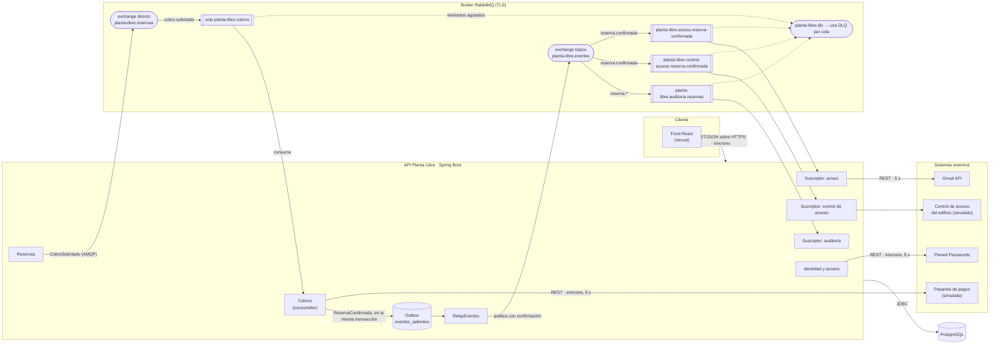
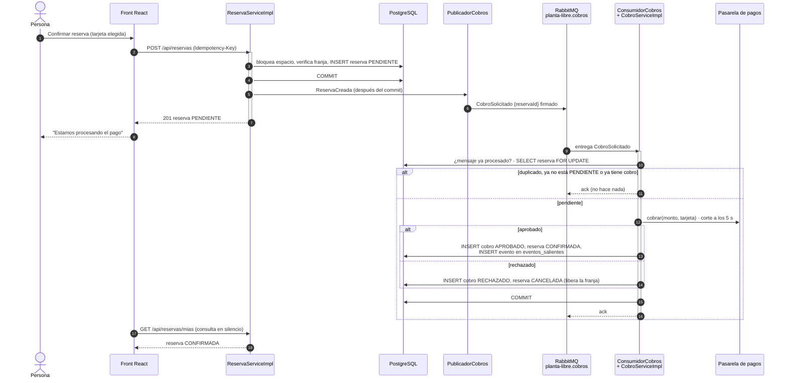
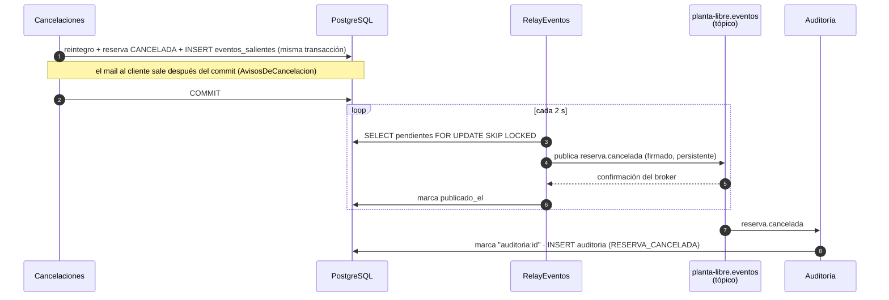
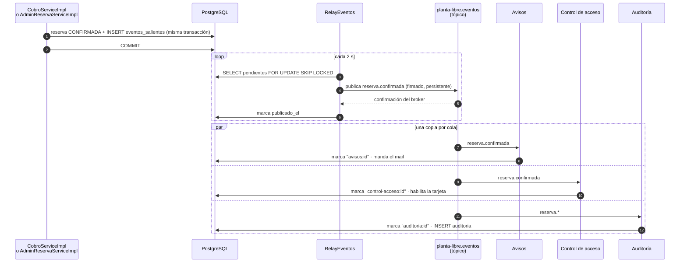

# Planta Libre — Arquitectura de integración

**Versión vigente · 19 de noviembre de 2026**
Complementa al [documento técnico](DocumentoTecnico.md) y al [dominio de reservas](DominioReservas.md). Las pruebas de todo lo que se describe acá están en el [plan de pruebas](PlanDePruebas.md).

Este documento cubre:

1. el mapa de integración: qué componentes internos y qué sistemas externos se conectan, y por qué canal;
2. la clasificación justificada de cada integración en síncrona o asincrónica (cola o tópico);
3. el proceso de **cobro de una reserva**, sobre una cola punto a punto;
4. el evento **reserva confirmada**, sobre un tópico con *transactional outbox* y tres suscriptores;
5. la resiliencia hacia afuera y las garantías de la API REST: timeout, circuit breaker, Idempotency-Key, ETag y Problem Details;
6. cómo levantarlo y qué mostrar en la demo;
7. los límites conocidos.

---

## 1. Mapa de integración



**Componentes internos.** La API es un monolito modular (ver el documento técnico, sección 2). Los que hablan con afuera lo hacen a través de un puerto propio, así que cambiar de proveedor es cambiar un adaptador:

| Puerto | Adaptador actual | Envoltorio |
|---|---|---|
| `EmailService` | `SmtpEmailService` o `GmailApiEmailService` (Strategy) | Timeout de 5 s; envío en otro hilo |
| `PasarelaPagos` | `PasarelaPagosSimulada` | `PasarelaPagosResiliente`: timeout de 5 s y circuit breaker |
| `ConsultaFiltraciones` | `PwnedPasswordsCliente` | Timeout de 5 s |
| `ControlAcceso` | `ControlAccesoSimulado` | Lo llama un suscriptor del tópico |

Los servicios de negocio no conocen RabbitMQ: publican eventos de dominio de Spring (`ReservaCreada`, `ReservaConfirmada`), y es el paquete `mensajeria` el que los convierte en mensajes. Si el broker cambia (ActiveMQ, SQS), se reemplaza ese paquete y nada más.

---

## 2. Clasificación de las integraciones

| Integración | Sentido | Canal | Tipo |
|---|---|---|---|
| Front React ↔ API | entrante | REST/JSON sobre HTTPS | Síncrona |
| Reservas → Cobros | interna | Cola punto a punto (AMQP) | **Asincrónica** |
| Cobros → Pasarela de pagos | saliente | REST/JSON | Síncrona, dentro del proceso asincrónico |
| Reserva confirmada → avisos, control de acceso, auditoría | interna → varios | Tópico pub/sub (AMQP) con outbox | **Asincrónica** |
| Avisos → Gmail API | saliente | REST/JSON sobre HTTPS (OAuth 2) | Síncrona, fuera del pedido |
| Identidad → Pwned Passwords | saliente | REST sobre HTTPS | Síncrona, dentro del pedido |
| Suscriptor → Control de acceso del edificio | saliente | Puerto `ControlAcceso` (simulado) | Síncrona, dentro del proceso asincrónico |

### Por qué cada una

**Front ↔ API: REST síncrono.** La persona está mirando la pantalla y necesita la respuesta para seguir: si la franja quedó tomada, la alternativa más cercana, el error de validación. Es pedido y respuesta, y REST/JSON es lo natural para un navegador.

**Cobro de la reserva: asincrónico, con cola punto a punto.**

- *Por qué asincrónico.* Cobrar depende de un tercero que puede tardar o estar caído. Si el cobro corriera dentro del `POST /api/reservas`, una pasarela lenta dejaría a la persona esperando, y la transacción mantendría bloqueado el espacio todo ese tiempo. Separado, la reserva se guarda en milisegundos como `PENDIENTE` y el cobro llega unos segundos después. Si la pasarela está caída, el mensaje espera y se reintenta, sin perder la reserva.
- *Por qué cola y no tópico.* Cada pedido de cobro tiene que procesarse **una sola vez, por un solo consumidor**: si dos instancias leyeran el mismo mensaje, se cobraría dos veces. Es el caso de libro del punto a punto. Con más instancias, la cola reparte los mensajes entre ellas (consumidores competidores) y el trabajo escala sin cambios.
- *Por qué la llamada a la pasarela es síncrona.* El consumidor necesita saber si el pago se aprobó para decidir el estado de la reserva. Los proveedores actuales (Mercado Pago, Stripe) exponen REST. Lo asincrónico es el proceso visto desde la persona, no cada llamada.

**Reserva confirmada: tópico pub/sub.** Cuando una reserva se confirma hay varios interesados independientes:

- avisarle al cliente por mail;
- habilitar su tarjeta en el control de acceso del edificio;
- registrarlo en la auditoría.

Ninguno debería conocer a los otros, y agregar uno nuevo no debería tocar al publicador. Eso es un tópico: un mensaje, una copia por suscriptor. Cada suscriptor tiene su propia cola, así que si uno está caído o falla, los otros siguen.

La auditoría se suscribe con el patrón `reserva.*` y no con la clave exacta: hoy recibe `reserva.confirmada` y `reserva.cancelada`, y cualquier evento nuevo de reservas le llega sin cambiar la topología.

**Gmail API: REST síncrono, fuera del pedido.** Google ofrece el envío solamente como API REST. La llamada se hace en otro hilo (`@Async`), con un timeout de 5 s, para que el tiempo de respuesta no revele si una cuenta existe y para que una falla del correo no rompa el flujo.

El mail de confirmación de una reserva sale de un suscriptor del tópico, así que si la aplicación se reinicia, el mensaje sigue en la cola. Los mails que no pasan por el tópico (registro, recuperación, cancelación) no tienen esa garantía (sección 7).

**Pwned Passwords: REST síncrono, dentro del pedido.** Al registrarse o cambiar la contraseña se consulta si la contraseña aparece en filtraciones conocidas. Tiene que ser síncrono porque la respuesta decide si se acepta la contraseña. Solo salen los primeros cinco caracteres del hash SHA-1 (k-anonimato). Si el servicio no responde en 5 s, se omite la verificación externa y se registra en el log; la lista local se verifica igual.

**Sin SOAP.** Todos los sistemas externos con los que se integra Planta Libre exponen REST: Gmail, Pwned Passwords y los proveedores de pago. La facturación electrónica con ARCA (WSFEv1), que una versión anterior de este documento preveía como integración SOAP, quedó fuera del alcance del sistema.

---

## 3. Cobro de una reserva (cola punto a punto)

### Qué pasa

1. La persona confirma la reserva y elige la tarjeta. `POST /api/reservas`:
   - valida y bloquea el espacio;
   - guarda la reserva como `PENDIENTE` junto con la tarjeta elegida;
   - marca en la misma transacción que su cobro está pedido (`reservas.cobro_solicitado_el`);
   - publica el evento de dominio `ReservaCreada`.
2. **Después del commit**, `PublicadorCobros` envía `CobroSolicitado` al exchange `planta-libre.reservas` con la clave `cobro.solicitado`, firmado con HMAC. La API ya respondió `201`.
3. El broker enruta el mensaje a la cola durable `planta-libre.cobros`.
4. `ConsumidorCobros` verifica la firma y llama a `CobroServiceImpl.procesar`, que en **una sola transacción**:
   - descarta el mensaje si su id ya está en `mensajes_procesados` y, si no, lo registra;
   - bloquea la fila de la reserva (`SELECT ... FOR UPDATE`);
   - si ya no está pendiente (la cancelaron o la confirmó un administrador) o ya tiene un cobro, no hace nada;
   - calcula el monto con el `Tarifario` (tarifa por hora del tipo de espacio, prorrateada por minuto);
   - cobra a la tarjeta elegida o, si no hay una, a la principal del cliente, con un límite de 5 s;
   - guarda el `Cobro` y deja la reserva `CONFIRMADA` si se aprobó, o `CANCELADA` si se rechazó, con lo que la franja queda libre otra vez;
   - si se aprobó, escribe el evento `ReservaConfirmada` en el outbox (sección 4).
5. Si se rechazó, `AvisosDeCobro` manda después del commit el mail "No pudimos cobrar tu reserva", con el motivo. Si se aprobó, el mail de confirmación lo manda el suscriptor de avisos del tópico.
6. En el front, *Mis reservas* vuelve a consultar en silencio unas veces después de reservar, y la reserva pasa de *Pendiente* a *Confirmada* sin recargar la página.

### Diagrama de secuencia



### Topología

La declara la aplicación al arrancar (`MensajeriaConfig`). RabbitMQ crea lo que falte.

| Objeto | Nombre | Para qué |
|---|---|---|
| Exchange directo | `planta-libre.reservas` | Entrada del dominio de reservas. La clave `cobro.solicitado` lleva a la cola de cobros |
| Cola durable | `planta-libre.cobros` | Punto a punto. Sobrevive a un reinicio del broker. Los rechazos van al DLX |
| Exchange directo | `planta-libre.dlx` | Exchange de mensajes muertos, compartido por todas las colas |
| Cola durable | `planta-libre.cobros.dlq` | Mensajes que agotaron los reintentos o llegaron con firma inválida |

El mensaje viaja en JSON y lleva solamente el id de la reserva. El consumidor lee el estado actual de la base, así que un mensaje que llega tarde nunca actúa sobre datos viejos:

```json
{ "reservaId": 42, "solicitadoEl": "2026-10-19T12:03:10.512Z" }
```

### Qué pasa cuando algo falla

| Falla | Comportamiento |
|---|---|
| La reserva no se pudo guardar (franja tomada, validación) | La transacción hace rollback y el evento nunca sale: el publicador escucha **después del commit** |
| La pasarela rechaza el pago | No es un error: se guarda el cobro `RECHAZADO`, la reserva queda `CANCELADA`, la franja se libera y llega el mail |
| La pasarela falla técnicamente o no responde en 5 s | Toda la transacción hace rollback: no queda cobro guardado y la reserva sigue `PENDIENTE`. El listener lo intenta 3 veces en total, esperando 2 s y después 4 s. Si sigue fallando, el mensaje va a `planta-libre.cobros.dlq` y `MonitorDlq` avisa |
| El mismo mensaje llega dos veces | El id del mensaje queda en `mensajes_procesados` en la misma transacción del cobro, así que la copia se descarta. Además `cobros.reserva_id` es `UNIQUE`: no se cobra dos veces |
| Un mensaje sin firma o con la firma alterada | Va directo a la DLQ sin llegar al cobro y queda en la auditoría (`MENSAJE_FIRMA_INVALIDA`) |
| La persona cancela mientras se está cobrando | Cancelar y cobrar bloquean la misma fila, así que se ejecutan uno después del otro. Si gana la cancelación, el consumidor la ve `CANCELADA` y no cobra |
| El broker está caído cuando se crea la reserva | La reserva se guarda igual, con su cobro marcado como pedido. El envío falla y queda en el log. `BarridoCobros` revisa cada minuto las reservas `PENDIENTE` cuyo cobro lleva más de 2 minutos sin resolverse y vuelve a pedirlo; cuando el broker vuelve, el cobro sale. Si después de 3 pedidos sigue sin resolverse, cancela la reserva, libera la franja y avisa por mail. No se pierde ningún cobro |

### Tarifas

`app.tarifas.por-hora` en `application.yml`. La aplicación no arranca si falta la tarifa de un tipo de espacio.

| Tipo | Por hora |
|---|---|
| Cubículo | $ 3.500 |
| Sala de reuniones | $ 9.000 |
| Sala de presentaciones | $ 14.000 |
| Sala de conferencias | $ 22.000 |

---

## 4. Reserva confirmada (tópico pub/sub con outbox)

### Qué pasa

1. Una reserva pasa a `CONFIRMADA`, por uno de dos caminos:
   - el consumidor de cobros aprobó el pago (sección 3);
   - un administrador la pasó de *Pendiente* a *Confirmada* (`PUT /api/admin/reservas/{id}`).

   En los dos casos se publica el evento de dominio `ReservaConfirmada`. Lleva la reserva, el espacio, la franja, el cliente y el origen (`COBRO` o `ADMINISTRADOR`), y el monto y la tarjeta cuando hubo cobro.
2. **En la misma transacción**, `OutboxEventos` escucha el evento con `BEFORE_COMMIT` y lo escribe en la tabla `eventos_salientes`, con un id de mensaje fijo. Si la transacción hace rollback, el evento desaparece con ella; si confirma, el evento queda guardado aunque el broker esté caído o la aplicación se caiga un instante después.
3. `RelayEventos` revisa el outbox cada 2 segundos:
   - toma los eventos pendientes en orden (`FOR UPDATE SKIP LOCKED`, así varias instancias no mandan el mismo);
   - los publica en el exchange de tipo tópico `planta-libre.eventos`, con la clave `reserva.confirmada`, firmados con HMAC;
   - **espera la confirmación del broker** (*publisher confirms*) y recién ahí los marca como publicados.
4. El broker entrega una copia a cada cola cuyo patrón coincide con la clave, y cada suscriptor procesa la suya.

| Suscriptor | Cola | Patrón | Qué hace |
|---|---|---|---|
| Avisos | `planta-libre.avisos.reserva-confirmada` | `reserva.confirmada` | Manda "Tu reserva está confirmada" con el monto y la tarjeta. Si la confirmó un administrador no manda nada, porque el cliente ya recibió el mail "Cambió tu reserva" |
| Control de acceso | `planta-libre.control-acceso.reserva-confirmada` | `reserva.confirmada` | Habilita la tarjeta del cliente en la puerta del espacio para la franja reservada, a través del puerto `ControlAcceso` |
| Auditoría | `planta-libre.auditoria.reservas` | `reserva.*` | Registra `RESERVA_CONFIRMADA` o `RESERVA_CANCELADA` en la bitácora, con el código, el espacio, la franja y cómo terminó la reserva |

Los dos primeros heredan de `SuscriptorEventos` (patrón Template Method), que fija el orden de lo común. Cada uno solo dice qué cola lee y qué hace con el evento:

1. verifica la firma;
2. convierte el JSON;
3. dentro de una transacción, marca el mensaje como procesado **por ese suscriptor** y lo procesa.

La auditoría usa el mismo esqueleto, pero su cola escucha todo el tópico, así que después de convertir el JSON decide qué evento recibió: `ReservaConfirmada` o `ReservaCancelada`. Un evento que no conoce se rechaza hacia su DLQ en lugar de descartarse en silencio.

### La cancelación también pasa por el tópico

Una reserva no solo se confirma: también se cancela, la cancela el cliente, la elimina un administrador, o la barre un bloqueo del espacio. `Cancelaciones` es el único camino por el que una reserva deja de ocupar su franja, así que ahí se publica `ReservaCancelada` y `OutboxEventos` la guarda en `eventos_salientes` con la clave `reserva.cancelada`, en la misma transacción que el reembolso y el cambio de estado.



Las colas de avisos y de control de acceso están atadas a `reserva.confirmada`, así que una cancelación no las despierta: solo llega a la auditoría. Si mañana el control de acceso tiene que revocar la tarjeta al cancelar, alcanza con atar esa cola también a `reserva.cancelada` y leer el evento nuevo; el publicador no se toca.

### Diagrama de secuencia



### Topología

| Objeto | Nombre |
|---|---|
| Exchange tópico | `planta-libre.eventos` |
| Colas durables | `planta-libre.avisos.reserva-confirmada`, `planta-libre.control-acceso.reserva-confirmada`, `planta-libre.auditoria.reservas` |
| DLQ de cada una | el mismo nombre con `.dlq`, a través de `planta-libre.dlx` |

`MonitorDlq` vigila las cuatro DLQ (cobros y las tres del tópico) y avisa cuando entra un mensaje.

El usuario de la aplicación en el broker solo puede crear, escribir y leer objetos que empiecen con `planta-libre.` (SEC-07), y todos estos lo cumplen.

### Garantías

- **No se pierde ningún evento con el broker caído.** El evento existe en la base si y solo si la reserva quedó confirmada. Mientras el broker no confirma la recepción, el evento sigue pendiente y el relay lo vuelve a intentar en la pasada siguiente. Cuando el broker vuelve, salen todos, en el orden en que se escribieron.
- **Se procesa una sola vez.** La entrega es *al menos una vez*: si el broker confirmó pero la marca de publicado no llegó a guardarse, el evento sale de nuevo. Sale con el mismo id de mensaje, y cada suscriptor descarta la copia gracias a `mensajes_procesados`, con la clave `suscriptor:id`. La inserción es atómica (`ON CONFLICT DO NOTHING`), así que dos copias simultáneas tampoco pasan.
- **Mensajes inválidos o que fallan.** Un mensaje sin firma válida va directo a la DLQ de esa cola. Uno cuyo procesamiento falla se reintenta 3 veces (2 s y 4 s de espera) y después va a la DLQ, donde se puede inspeccionar y reprocesar desde la consola de RabbitMQ. Como la marca de procesado está en la misma transacción, un fallo la revierte y el reintento procesa de verdad.
- **Independencia.** Si un suscriptor falla, los otros dos ya procesaron su copia: cada cola es independiente.
- **Persistencia en el broker.** Los mensajes se publican persistentes en colas durables, así que un reinicio del broker no los borra.

### Qué pasa cuando algo falla

| Falla | Comportamiento |
|---|---|
| La transacción que confirma hace rollback | El evento no queda en el outbox: nunca se avisa una confirmación que no ocurrió |
| El broker está caído | Los eventos quedan pendientes en `eventos_salientes`, con `intentos` y `ultimo_error`. El log avisa una vez por evento. Cuando el broker vuelve, el relay los publica en orden |
| La aplicación se cae entre el commit y la publicación | El evento está en la tabla; lo publica el relay al arrancar, o el de otra instancia |
| El broker recibió el evento pero se perdió la confirmación | Se publica de nuevo con el mismo id y los suscriptores descartan la copia |
| Un suscriptor falla (mail caído, error inesperado) | Se reintenta 3 veces y va a su DLQ. Los otros suscriptores no se enteran |
| Mensaje con la firma alterada | A la DLQ de cada cola, sin procesarse, y queda en la auditoría |

Los eventos publicados se borran a los 7 días (`app.mensajeria.outbox.conservar-dias`): el outbox no es un archivo histórico.

---

## 5. Resiliencia y API REST

### 5.1 Timeout de 5 s, circuit breaker y fallback

Toda llamada a un sistema externo tiene un límite de 5 segundos. Si no responde en ese tiempo, la llamada se corta y se aplica un fallback definido. Ningún hilo queda colgado.

| Sistema externo | Cómo se corta | Fallback | Qué ve la persona |
|---|---|---|---|
| Pasarela de pagos: cobro (dentro del proceso asincrónico) | `PasarelaPagosResiliente`: TimeLimiter de Resilience4j a 5 s, que interrumpe el hilo, más un circuit breaker | La transacción hace rollback y el mensaje se reintenta (3 intentos, después DLQ). El barrido lo vuelve a pedir y, si no hay caso, cancela la reserva y libera la franja | La reserva figura *Pendiente* mientras tanto. Si se cancela, le llega el mail "No pudimos cobrar tu reserva" |
| Pasarela de pagos: reintegro (dentro de la cancelación) | El mismo decorador | La cancelación hace rollback: la reserva sigue activa y no se devolvió nada | `503` en Problem Details, con `Retry-After: 30` y el texto "La pasarela de pagos no respondió. Tu reserva no cambió; probá de nuevo en unos minutos." |
| Pwned Passwords (alta y cambio de contraseña) | Timeout de conexión y de lectura de 5 s | Se omite la verificación externa y queda en el log; la lista local se verifica igual | El registro sigue normalmente |
| Gmail API (mails) | Timeout de conexión y de lectura de 5 s | El mail se registra como no enviado en el log. Corre en otro hilo, así que nunca demora la respuesta | Nada: la operación ya respondió |

**Circuit breaker de la pasarela.** Mira las últimas 10 llamadas y empieza a evaluar desde la 5.ª. Si fallaron la mitad o más, se abre y durante 30 s las llamadas fallan al instante, sin esperar los 5 s cada una. Después deja pasar 2 de prueba: si salen bien, se cierra. Un pago rechazado por el emisor no cuenta como falla: es una respuesta válida.

Configuración (`application.yml`): `app.pasarela.timeout-ms` (5000), `app.pasarela.circuito.abierto-segundos` (30).

### 5.2 Idempotency-Key

Los endpoints de alta aceptan la cabecera `Idempotency-Key`: `POST /api/reservas`, `POST /api/admin/reservas` y `POST /api/usuarios/me/medios-pago`. Los marca la anotación `@Idempotente` y los atiende `IdempotenciaFilter`, que corre después de Spring Security. Así, la clave es de cada usuario.

| Caso | Respuesta |
|---|---|
| Primera vez con una clave | Se procesa normalmente y se guarda la respuesta (status y cuerpo) |
| Misma clave y mismo pedido | La respuesta guardada, idéntica, con `Idempotent-Replayed: true`. No se crea nada |
| Misma clave mientras el primero sigue en curso | `409` `IDEMPOTENCY_KEY_EN_CURSO` |
| Misma clave con otro cuerpo u otra ruta | `422` `IDEMPOTENCY_KEY_REUTILIZADA` |
| Clave con menos de 8 o más de 255 caracteres, o con espacios | `400` `IDEMPOTENCY_KEY_INVALIDA` |
| El primero falló del lado del servidor (5xx) | La clave se libera para reintentar con ella |

- **Dónde se guardan las claves:** en la tabla `claves_idempotencia` (V27). La clave primaria `(usuario, clave)` hace que, de dos pedidos simultáneos, solo uno la tome.
- **Vigencia:** una clave vale 24 horas. Una que quedó *en curso* más de un minuto, porque la instancia se cayó a mitad de camino, se descarta.
- **Sin la cabecera:** el endpoint funciona igual.
- **El front:** manda una clave por operación y la reutiliza si tiene que reintentar sin haber recibido respuesta. Así, un doble clic o un corte de red no crean dos reservas.

### 5.3 ETag e If-Match

Los recursos que se pueden modificar devuelven `ETag`:

- `GET /api/reservas/{id}`
- `GET /api/usuarios/me/medios-pago/{id}`
- `GET /api/usuarios/me`
- también las respuestas de sus PUT y PATCH.

El ETag es la versión del recurso (`"7"`). La incrementa la base de datos con un trigger en cada `UPDATE` (V28), así que ningún camino de escritura puede olvidarse de hacerlo.

`PUT /api/admin/reservas/{id}`, `PUT /api/usuarios/me/medios-pago/{id}` y `PATCH /api/usuarios/me` aceptan `If-Match`:

1. el servicio bloquea la fila (`SELECT ... FOR UPDATE`);
2. compara la versión;
3. si cambió desde que el cliente la leyó, responde `412` `RECURSO_MODIFICADO` sin aplicar nada.

Como la comparación se hace con la fila bloqueada, de dos administradores que editan a la vez con el mismo ETag, el segundo recibe 412 aunque los pedidos lleguen juntos. Sin `If-Match` el cambio se aplica igual. El front manda el ETag de la última lectura al editar una reserva (administrador) y el perfil.

### 5.4 Errores en Problem Details

Todas las respuestas de error usan el formato de la RFC 9457, `application/problem+json`. Esto incluye las de los filtros de seguridad, el rate limit y la Idempotency-Key.

- **Miembros del estándar:** `type`, `title`, `status`, `detail` e `instance`.
- **Miembros que ya leía el front:** `message`, `code` y `errors` se mantienen como extensiones.
- **Códigos:** 400, 401, 403, 404, 405, 409, 412, 415, 422, 429, 500 y 503.
- **Errores inesperados:** nunca llevan el stack trace al cliente.

---

## 6. Cómo correrlo y qué mostrar

```bash
docker compose up --build
```

Levanta todo con la mensajería activada: base, broker, backend y front (ver el [README](../README.md)).

- **Aplicación web:** http://localhost:8088.
- **Consola de RabbitMQ:** http://localhost:15672, con el usuario `planta-libre-admin`. Su contraseña se lee con `docker compose exec back cat /secretos/rabbitmq_admin_password`.

### Tarjetas de prueba de la pasarela simulada

| Tarjeta | Resultado |
|---|---|
| Cualquier tarjeta válida, por ejemplo `4242 4242 4242 4242` | Aprobada: la reserva pasa de *Pendiente* a *Confirmada* en unos 2 segundos, y llegan el mail de confirmación, la habilitación del control de acceso (en el log) y la entrada de auditoría |
| `4000 0000 0000 0002` | Rechazada: la reserva queda *Cancelada*, el horario se libera y llega el mail de rechazo |
| `4000 0000 0000 0119` | Falla técnica: 3 intentos en el log, la reserva sigue *Pendiente* y el mensaje aparece en `planta-libre.cobros.dlq` |
| `4000 0000 0000 0077` | La pasarela no responde: 3 cortes a los 5 s en el log y el mensaje en la DLQ |

### Recorrido de demo

1. **Cobro y tópico.** Reservar con `4242`. En la consola de RabbitMQ se ven el mensaje pasando por `planta-libre.cobros` y después una copia en cada una de las tres colas del tópico. En el log aparecen `Outbox: evento N publicado` y `Control de acceso: tarjeta de … habilitada`. En la auditoría (`/api/admin/auditoria`) queda `RESERVA_CONFIRMADA`.
2. **Broker apagado.**
   1. `docker compose stop rabbitmq`.
   2. Confirmar a mano una reserva pendiente como administrador. La API responde normalmente.
   3. En la base, el evento queda pendiente: `SELECT id, intentos, ultimo_error FROM eventos_salientes WHERE publicado_el IS NULL`.
   4. `docker compose start rabbitmq`. En unos segundos el relay lo publica y los suscriptores lo procesan.

   Lo mismo con una reserva nueva: queda *Pendiente* y el barrido pide su cobro cuando el broker vuelve.
3. **Reintegro sin respuesta.** Levantar con `PASARELA_DEMORA_REINTEGRO_MS=8000 docker compose up` y cancelar una reserva confirmada: a los 5 s responde 503 y la reserva sigue *Confirmada*.
4. **Idempotency-Key y ETag.** En la colección de Postman: "Reservar otra vez con la misma clave (doble clic)" y "Editar … con un ETag viejo".

Sin `MENSAJERIA_HABILITADA=true` la aplicación arranca sin necesitar el broker: las reservas quedan pendientes hasta que las confirma un administrador, y no se escriben eventos en el outbox. En Render queda apagada hasta configurar `RABBITMQ_URL` con un broker en la nube, por ejemplo la URL `amqps://` de una instancia gratuita de CloudAMQP.

---

## 7. Límites conocidos

- **El cobro usa barrido, no outbox.** El pedido de cobro se publica después del commit; si el broker está caído, `BarridoCobros` lo vuelve a pedir, con una demora de hasta 3 minutos. Es seguro (no se pierde), pero más lento que el outbox del tópico. Pasarlo al mismo outbox es directo: escribir `CobroSolicitado` en `eventos_salientes` en lugar de publicarlo.
- **La pasarela y el control de acceso son simulados.** Los puertos `PasarelaPagos` y `ControlAcceso` ya están separados: un proveedor real es otro adaptador, y la pasarela real queda envuelta por `PasarelaPagosResiliente` igual que la simulada.
- **Reintegros sincrónicos.** Al cancelar, el reintegro se pide a la pasarela dentro de la misma transacción (ver la política de cancelación en [DominioReservas.md](DominioReservas.md)). Si no responde en 5 s, la cancelación no se aplica y se pide reintentar. Con un proveedor real conviene pasarlo también a una cola.
- **Mails fuera del tópico.** Los mails de registro, recuperación, cancelación y edición se mandan en otro hilo, sin cola: si la aplicación se reinicia justo en ese momento, el mail se pierde. Solo el de confirmación pasa por el tópico.
- **Dos eventos en el tópico: `reserva.confirmada` y `reserva.cancelada`.** Los dos salen por el outbox, en la misma transacción que el cambio de la reserva. La cancelación llega solo a la auditoría, que escucha `reserva.*`; el mail de cancelación sigue saliendo en proceso, después del commit, y es el próximo candidato a pasar por el tópico.
